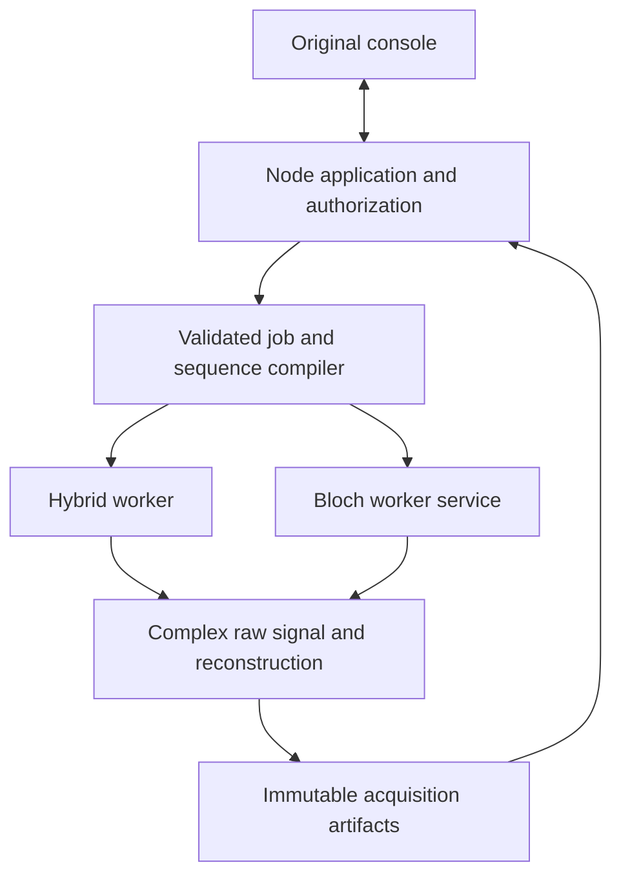

# Real-time MRI engine strategy and implementation plan

**Decision ID: MRI-ENGINE-001 · November 23, 2026 · Status: adopted architectural direction; implementation deferred.**

The user selected a digital-phantom → sequence/physics → generated raw signal/k-space → reconstruction approach. This document is the restart point when the user asks to pursue the real-time imaging engine. Baseline: **V 1.1.0, HEAD 167f470**. No engine, application behavior, infrastructure purchase or dependency installation is delivered by this planning task.

## Decision and recommended implementation path

Generate images from intrinsic tissue properties and the prescribed acquisition rather than an image library. Use **one versioned acquisition contract with two physics backends**:

1. **Hybrid analytic/EPG-capable forward model** for responsive routine teaching: tissue fractions and geometry → sequence-dependent complex magnetization → explicit encoding/sampling → complex receiver noise → reconstruction. Start on bounded CPU workers, benchmark, then accelerate measured bottlenecks.
2. **Waveform-driven Bloch backend** for effects that require RF/gradient history and intra-voxel evolution. Evaluate **headless KomaMRI** first; maintain a small independent CPU reference. Add a GPU worker service after a pinned-version, fidelity and performance proof. CUDA on a provisioned Linux GPU is a candidate deployment; Metal on the user's Mac is a development option, not a classroom dependency.

Both backends return the same raw-data/result envelope, declare their capabilities and preserve provenance. A fast preview is explicitly provisional; an acquisition becomes evidence only after successful guarded persistence. Unsupported physics is rejected or labeled unsupported, never silently replaced by a cosmetic effect or a different backend.

This extends our current analytic model instead of discarding working workflow, isolation, protocol versioning and reconstruction tests. Do not begin with a custom CUDA engine, a GPU cluster, browser-only full Bloch simulation, or clinical DICOM/PACS transport. Those choices create cost and integration risk before a representative benchmark exists.

## Corrections and boundaries in the supplied architecture

These qualifications retain the proposed direction while making it implementable. They are not findings from an interactive inspection of Corsmed's proprietary engine.

| Supplied proposition | Planning interpretation |
| --- | --- |
| Corsmed/coreMRI is a reusable open-source blueprint | The coreMRI paper establishes a cloud/GPU Bloch architecture and author ties to corsMED. It describes available executables and explicitly withheld protected software. Public access and an open-access paper do not establish that the entire implementation is open-source or reusable. Use it as architecture evidence, not a code dependency or proof of exact commercial lineage. R1. |
| BrainWeb and McGill SBD are two sources of ready quantitative maps | They are related parts of the same BrainWeb/McGill resource. The reviewed anatomy comprises fuzzy memberships/discrete labels; tissue parameter values are supplied separately, including a historical 1996 table. Build and version an explicit tissue-property assignment rather than treating weighted images as quantitative ground truth. Dataset redistribution/product-use terms remain to be established before importing assets. R5–R7. |
| A universal ≤1 mm³ voxel satisfies Nyquist | Phantom anatomy resolution, integration/isochromat density, output sampling and k-space extent are different constraints. Select spatial/time discretization by convergence and the smallest relevant anatomy/field variation; interpolation cannot restore missing structures. Refine around RF profiles, field gradients and boundaries. |
| Solve every voxel at every microsecond | Use a rotating frame, event boundaries, adaptive/validated RF discretization, analytic free precession and relaxation where valid, and streamed ADC reductions. Carry magnetization history between repetitions and slices; do not reset each slice to equilibrium or discard potentially re-excited/out-of-FOV spins. R2/R3/R8. |
| Artifacts emerge automatically | Only represented mechanisms emerge. Susceptibility needs a B0/off-resonance distribution and spatial dephasing; cross-talk needs nonideal RF profiles and sequential slice history; motion/flow needs trajectories. Diffusion/exchange/MT and scanner imperfections need extensions beyond basic Bloch equations. |
| Multiply evolved magnetization by an extra Fourier phase and density | Pick a normalization and encoding convention. If the solver already includes density and gradient-induced phase, multiplying them again double-counts signal/encoding. The two consistent formulations below are alternatives. R8/R9. |
| Noise is fully authentic after a few scaling factors | Build a calibrated educational receiver model with explicit units, coil covariance, FFT normalization and averaging. Voxel-volume signal must not also be counted as an independent noise penalty. Absolute patient/scanner SNR cannot be claimed without calibrated hardware/tissue data. R10/R11. |
| CPU always takes 15–30 minutes; GPU always takes 2–5 seconds | Neither range is a general requirement or measured result for this project. CPU analytic/FFT and small reference Bloch problems are useful. GPU benefit depends on spins, events, ADC samples, coils, batching, transfers and precision. Benchmark cold/warm and whole-class workloads before selecting hardware. |
| Hybrid necessarily loses FSE blurring | Echo-dependent k-space weighting and EPG-based signal evolution can represent important FSE effects without full spatial time stepping (R15). V 1.1.0 already includes simplified tissue-specific FSE phase weighting. Preserve that coverage; arbitrary blur and full Bloch/EPG are not equivalent. |
| Reconstruction is always iFFT then DICOM push | iFFT is the first Cartesian baseline. Non-Cartesian data require a matching gridding/NUFFT/operator path; partial Fourier requires an actual reconstruction method. DICOM is an optional interoperability stage, separate from rendering and from confirmed PACS delivery. R12. |

## Existing implementation and integration seams

| Existing component | Retain / planned evolution |
| --- | --- |
| `public/mr-physics.js` | Preserve analytic-mr-v3 behavior and tests as legacy/reference. Separate fast UI estimates from authoritative compiled acquisition calculations; version both. |
| `public/mr-geometry.js`, `src/mr.js` | Preserve patient-coordinate/orientation conventions, finite-voxel and oblique tests. Introduce a phantom/field accessor and independent acquisition geometry; do not assume an output voxel equals one tissue voxel or one isochromat. |
| `src/mr-reconstruction.js` | Existing mixed-radix one-axis FSE transform is not a complete 2D/3D acquisition/reconstruction engine. Retain its tests; add a normalized complex transform/encoding API behind a separate engine version. |
| `src/mr-executor.js`, `src/mr-worker.js` | Existing bounded worker queue becomes an adapter behind durable acquisition jobs. Never run large Julia/GPU work inside the Node request/event loop. |
| `src/app.js` scan handler | Currently awaits generation, rechecks the session and saves under the original workflow revision. Future asynchronous submission/status/result endpoints must preserve these authorization and stale-result checks. |
| `src/db.js` acquisitions / `saveAcquisition` | Preserve immutable old bytes, source/engine versions, idempotent scan keys, institution/owner filters and Exam Begin/unlocked revision guard. Additive schema/artifact storage only; old series are never recomputed. |
| Protocol/default library and console | Keep student-private versions, protected institution defaults, loaded case-copy identities and explicit Run scan. Do not silently migrate immutable saved protocols into a different sequence model. |

Our current images are synthetic brain acquisitions with a fixed 1.5 T frequency assumption and 8-bit presentation pixels. They are not stored complex raw acquisitions. The new engine requires a float/complex internal path before magnitude/windowing; an FFT of already clipped display pixels would be an inadequate foundation.

## Computational contracts

### Phantom, tissue and hardware model

Use the [dataset/phantom preparation supplement](MRI_ENGINE_DATA_SOURCES.md) and [candidate register](mri-engine-data-sources.json) for the user-supplied BrainWeb, MRiLab, XCAT, TotalSegmentator MRI, AMOS, ACDC, MuscleMap, Visible Human/Zubal, discovery directories and fastMRI/OCMR sources. Entries D01–D13 distinguish ready structured objects, anatomy needing tissue assignment, software/models, discovery lists and raw reconstruction benchmarks. Release-specific counts and usage terms are recorded; none is adopted/imported. Preserve per-tissue fractions and sum complex signals rather than generally averaging T1/T2; treat Gaussian smoothing as an optional tested PSF/boundary assumption. The supplement contains the importer and acceptance procedure.

Start with our own asymmetric geometric phantom and synthetic brain fixture for reproducible tests. Next, evaluate BrainWeb fuzzy anatomy as an optional research fixture after rights/provenance review. Keep development possible without any external dataset. Add anatomical regions one at a time only after geometry and physics pass.

Use a JSON manifest plus chunked HDF5 numeric data for the science service, with an adapter-friendly logical schema. HDF5 is a container choice, not an adoption of another project's exact phantom layout. Record dataset ID/version/checksum, origin/license, dimension order, voxel-to-patient affine, axes/handedness, spatial units, tissue fractions/species, property-table source and applicable B0/temperature assumptions. Fractions must be bounded and sum appropriately; background is explicit. Zero-signal tissue must not produce divide-by-zero relaxation values.

Store or derive rho, T1 and T2 per tissue/species, chemical shift in ppm, and optional residual dephasing distribution. B0 maps (Hz), transmit B1+ (complex RF scale), receive Cc (complex coil sensitivity), noise covariance and motion trajectories are separate versioned fields. A T2* parameterization and an explicitly resolved B0 dispersion must not represent the same decay twice. Store assumptions where maps are absent; selecting a new field strength must not simply relabel an old tissue table.

For planning, map plane/stack/oblique prescription to patient coordinates. For simulation, integrate relevant spatial support, including out-of-FOV signal and RF-profile tails. Bound work using supported RF/geometry limits and error-tested pruning; a tight crop to the displayed FOV would erase the signal needed to generate wrap. Motion requires conservative support through the trajectory, not a static crop.

Memory planning must use actual representations. A 256³ scalar float32 field is 64 MiB; eight such fields alone are 512 MiB, excluding magnetization, coordinates, species, coils and workspaces. Stream/tile spin batches and ADC outputs; never allocate a spins × all-time-steps history by default. Sparse tissue fractions, lookup tables and shared resident anatomy can reduce memory after correctness is established.

### Sequence compiler and engine selection

Author a constrained, original intermediate representation for RF, gradient, delay, ADC, preparation, repetition and acquisition labels. Use SI internally: seconds, meters, tesla, T/m, Hz and cycles/m; distinguish gamma in rad/s/T from gamma-bar in Hz/T. Convert existing ms/mm/Hz-per-pixel inputs explicitly at the boundary. Store RF phase/frequency, shapes, sample rasters, gradient ramps/areas, ADC dwell/phase, echo/shot/slice/partition labels, dummy cycles and ordering.

Validate requested versus achieved TR, TE/effective TE, TI, slice profile/thickness, FOV, matrix, bandwidth and gradient amplitude/slew against the declared educational scanner profile. Compile actual timing instead of adjusting labels after a scan. Reject incompatible plans with a correctable explanation. Hardware limits are model constraints, not clinical safety certification or SAR approval.

Define a capability matrix per engine/family and require explicit selection at job creation. Initial new-engine families: Cartesian SE, spoiled GRE and IR; add validated FSE/EPG behavior before replacing current FSE acquisitions. Pulseq import/export is an adapter milestone, not unrestricted uploaded sequence execution: whitelist events/features, cap duration/samples/memory and reject unsupported labels/version semantics. No physical scanner output/control is introduced.

### Two consistent signal formulations

For normalized hybrid magnetization q, encode density exactly once:

\[
s_c(t_j)=\sum_p \rho_p V_p C_c(\mathbf r_p) q_p(t_j)
\exp[-i2\pi\mathbf k(t_j)\cdot\mathbf r_p]+n_c(t_j).
\]

Here q includes the explicitly declared relaxation/off-resonance/preparation effects but **excludes** the phase encoded by k. For a static, time-invariant contrast image, an appropriately scaled FFT may evaluate this efficiently; echo/readout-dependent signal requires time/echo-segmented operators or another validated factorization. Generating a cropped image and applying an identity FFT/iFFT is not a simulation of acquisition artifacts.

For a full Bloch state M that already includes density/equilibrium scaling and all gradient evolution, use:

\[
s_c(t_j)=\sum_p V_p C_c(\mathbf r_p)
[M_{x,p}(t_j)+iM_{y,p}(t_j)]+n_c(t_j).
\]

Do not apply another spatial encoding phase or rho in that expression. Define receiver demodulation/sign and complex-coil conjugation consistently; validate with known-position point spins. In motion models use positions and receive sensitivities at acquisition time. Susceptibility/flow/diffusion do not become implemented merely by adding fields to the manifest.

### Sampling, noise and reconstruction

Generate complex ADC samples with timestamps, trajectories and echo/shot/slice/partition/coil labels. Fix a Fourier sign, axis ordering, centering, quadrature weights and forward/inverse normalization. Use direct summation on tiny phantoms as an oracle; use FFT only when geometry and sampling meet its assumptions. Begin with Cartesian full sampling, then explicit phase undersampling/oversampling and finite k-space extent. Preserve outside-FOV object support to produce foldover.

Add seeded complex Gaussian receiver noise before reconstruction with an explicit covariance convention. Distinguish total receiver bandwidth from Hz/pixel; model receiver filtering/noise-equivalent bandwidth and ADC dwell together. Simulate independent averages and normalize once, or use the mathematically equivalent variance reduction. Validate signal-volume scaling, sqrt(NEX) behavior and bandwidth dependence under fixed stated conditions. Multicoil combination changes noise statistics; single-coil magnitude is not interchangeable with RSS or adaptive combination. Do not use per-image automatic contrast normalization to conceal these relationships.

Reconstruct complex float images first; derive magnitude and wrapped phase with explicit units. Keep acquired matrix separate from display interpolation. Add filters as saved reconstruction recipes, and identify their resolution/noise tradeoffs. Zero filling does not add acquired resolution; partial Fourier is not simple zero fill. Non-Cartesian reconstruction, acceleration, coil calibration and quantitative maps remain capability-gated future paths.

Persist lossless quantitative/raw artifacts where needed, immutable recon recipe and display transforms. Introduce a browser rendering adapter rather than forcing every result through the old 8-bit storage format. Optional DICOM export later needs correct patient-coordinate geometry, orientation/spacing, scaling, UIDs and image type, plus round-trip checks with an independent reader. It never automatically advances RIS Completed or asserts a PACS acknowledgment.

## Job, storage and classroom architecture

The Node application remains the authority for authentication, tenant scope, study state and persistence. A physics worker receives a pseudonymous immutable job, phantom/sequence hashes and resource limits; it does not need patient name/MRN or user session tokens and cannot edit the application database. The optional remote worker channel is authenticated/encrypted and bounded to the application's job/artifact protocol.

Proposed request envelope (contract, not an implemented endpoint): schema version, job/idempotency IDs, owner/institution/accession association held by the application, original workflow revision and case-copy/sequence revision, plan snapshot, phantom/field/compiler/engine/recon IDs and hashes, seed, precision, capability requirements and resource budget. Result envelope: exact resolved inputs/versions, actual timing, raw/trajectory and reconstructed artifact descriptors/checksums, achieved geometry, quality/model limitations, measured timings and backend/device evidence.

Use persistent `acquisition_jobs` records with queued → running → succeeded/failed/cancelled/expired states, attempt/lease IDs, bounded retry and heartbeat. Track draft previews separately. Submit returns promptly; UI polls an authorized status endpoint initially. Debounce local preview changes and discard superseded responses by request/revision ID; never persist a preview as an acquisition. Report compute queue time separately from simulation runtime and estimated physical acquisition duration.

Write result blobs to a new immutable temporary artifact set, verify dimensions/type/checksums and finite values, then reauthorize and atomically publish the database references. If the user loses access, the case ends/locks, a correction revision changes or the job is cancelled, reject publication and clean orphan artifacts. Two workers finishing one idempotency key must produce one acquisition. Crash/restart tests must cover queued, leased, uploaded-but-unpublished and published results. Do not hold a SQLite write transaction while computing or uploading.

Start with local immutable files plus metadata/manifests for large complex arrays; retain the current small SQLite pixel path for legacy compatibility. Back up database and referenced artifacts coherently, with content hashes and a manifest. Shared public phantom caches can be reused; student-specific plans/results/lesson edits remain scope-checked. Cache keys include all model/sequence/reconstruction versions, geometry, precision and noise seed; intentional new repeats get fresh noise seeds. An identical cached result does not imply a new independent noise realization.

For **30 or more independent users**, use bounded fair scheduling, per-user active/pending limits, weighted job sizes and a separate preview budget. Keep GPU workers warm and share read-only phantom data; isolate mutable magnetization/workspaces per job. Stop admission before memory exhaustion. Cancellation is cooperative at safe blocks and cannot publish a stale result. Do not start one GPU instance for every scan or leave unbounded cloud resources running. A configured worker/hour/spend cap is required before any cloud deployment.

## Backend choice and cost gates

| Candidate | Planned use / decision |
| --- | --- |
| Original CPU hybrid | First production candidate for bounded routine teaching and offline/ThinkPad operation, subject to whole-class benchmarks. Existing analytic behavior provides regression references, not a complete raw-data engine. |
| KomaMRI headless service | Preferred first Bloch integration spike: documented CPU/GPU execution, sequence/phantom support and raw output. Repository LICENSE inspected as MIT. Pin a release/commit plus Julia/dependency environment and check selected adapters/backends/data separately before adoption. No performance or numerical conformance is assumed. R2–R4. |
| JEMRIS | Candidate independent validation tool for selected matched experiments. Reviewed repository declares GPL v2 or later; keep evaluation/reuse decisions explicit and inspect the pinned package before distribution/integration. Not the initial application dependency. R13. |
| coreMRI | Published architecture/scalability reference. No assumption of an available fully open-source drop-in service or reuse rights for protected components. R1. |
| Custom CUDA / browser WebGPU | Defer. Consider only if profiling shows a specific bottleneck not resolved by the selected engine; require numerical equivalence and a maintenance/cost case. |

First benchmark the current CPU path, a new hybrid slice/stack, and equivalent small Koma CPU/GPU jobs. Separate compilation/startup, phantom upload, kernel/ADC reduction, reconstruction, transfer, queue and persistence. Record hardware, precision, spin/sample counts, sequence duration, peak memory and reproducibility. CPU reference and accelerated worker must match the same discretization and conventions.

Provisional product targets, **not measured guarantees**: local parameter/geometry feedback p95 ≤100 ms; provisional low-resolution preview p95 ≤500 ms on the selected client/worker profile; bounded routine 128² acquisition service time p95 ≤5 s on the selected engine hardware. Full-stack and Bloch targets are set after E0 measurements, not by silently reducing fidelity. A 30-user acquisition burst initially targets completion p95 ≤30 s on the designated classroom hardware; retain 60-user isolation regression coverage. Report overload explicitly and expose waiting state.

Capacity estimate: with B equal jobs of service time s and W genuinely concurrent equivalent slots, the ideal burst time is about ceil(B/W) × s, before overhead/variance. Thirty 5-second jobs with a 30-second budget require at least five equivalent slots in the idealized calculation. A GPU stream is not automatically a full-speed slot. Fit measured throughput, memory and cost rather than equating slots with GPU count. Record cost per completed classroom exercise and idle cost; no supplier pricing or cost ceiling has been approved in this plan.

## Phased delivery and exit gates

| Phase | Deliverables | Exit gate / dependencies |
| --- | --- | --- |
| **E0 — feasibility and contracts** | Tiny synthetic phantoms, reference signal/geometry conventions, benchmark harness, candidate Koma CPU/GPU experiment, dependency/data license register using D01–D13 and exact asset versions, backend capability matrix and latency/cost report. | Demonstrate matching SE/GRE echo/geometry/raw samples and identify affordable target hardware. Choose/pin engine and formats before runtime integration. No external dataset or cloud spend is prerequisite to synthetic CPU tests. |
| **E1 — jobs and compatibility** | Engine adapter around legacy generator, durable jobs, authorized status/results, cancellation/stale-result guards, artifact manifest and restart/backup handling. | Existing scans/protocols/lifecycle tests pass; old series byte-identical; idempotency, lock races and 30/60-user isolation pass. No new physics claim. |
| **E2 — phantom-driven hybrid acquisition** | Manifest/importer, complex tissue signal, patient-coordinate oblique sampling, Cartesian forward encoding, seeded receiver noise and 2D/3D reconstruction adapters. Start SE/GRE/IR; carry current FSE coverage until its replacement is validated. | Direct-sum/FFT, geometry, alias/noise/phase tests and CPU classroom benchmark meet declared bounds. No crop-induced loss of wrap; no auto-normalization or clipping before recon. |
| **E3 — waveform/reference physics** | Constrained compiler, RF/gradient/ADC histories, finite RF slice profiles, repeated-excitation state, independent CPU Bloch reference and FSE/EPG evaluation. | RF profile, echo timing/refocusing, steady state, inversion, slice-history and temporal/spatial convergence gates pass. A backend capability describes what was actually tested. |
| **E4 — accelerated Bloch service** | Pinned headless Koma adapter, resident phantom/compiled kernels, safe batching, block streaming and fair resource admission. | Matched CPU/GPU raw-signal accuracy and seeded-noise contracts pass; measured class burst, failure recovery and cost cap are acceptable. Keep the hybrid path for appropriate cases. |
| **E5 — deeper lessons and anatomy** | K-space viewer tied to actual sampled data, saved reconstruction experiments, mechanism-specific artifacts; later anatomy/coil/field and advanced sequences. | Each capability earns its own evidence, reviewed data and workload limits. Susceptibility, cross-talk, motion/flow and diffusion are separate models, not a single “realistic artifacts” switch. |
| **E6 — interoperability and release** | Optional DICOM/export integration after complex-data/geometry contract; documentation, original screenshots, rollout/rollback and host validation. | Independent metadata/pixel round trip and any PACS contract pass. Update guide/tips/version, publish only as separately authorized and verify ThinkPad/HTTPS/LAN on the actual host. |

Some E3/E0 reference experiments may precede E2 implementation. E4 never blocks ordinary hybrid classroom use. E5 UI work should use our existing task structure and the original candidates in [the video review](MR_CONSOLE_VIDEO_REVIEW.md); do not copy vendor screens, examples or assets.

## Verification matrix and release criteria

These are proposed engineering gates. E0 must record exact fixtures, tolerances and reasons before production changes; they are not a claim of current validation or clinical accuracy.

| Area | Required evidence |
| --- | --- |
| Basic physics | Known rotations and equilibrium recovery, FID T2 decay, ideal spin-echo refocusing, spoiled-GRE steady state/Ernst behavior, finite-TR IR sign/null and magnitude after mixing. Compare raw complex signals, not only similar-looking images. |
| Numerical conventions | Point spins at known asymmetric coordinates; k-space origin, sign, quadrature volume, frequency shift and coil phase. Tiny direct sum versus FFT round trip; phase errors evaluated only above a declared signal floor. |
| Sampling/convergence | Halve spatial integration and RF/time steps until declared signal/ROI and artifact endpoints converge; test higher field/off-resonance, oblique boundaries, smallest supported slices and long trains. No fixed grid is accepted for all settings. |
| Geometry | Asymmetric landmarks verify all planes, obliquity, translations, slice/partition centers, handedness, FOV and persistence. Full object support versus undersampled phase encoding must yield expected foldover. |
| SNR/reconstruction | Monte Carlo complex-noise mean/covariance, magnitude/RSS statistics as applicable, average and bandwidth ratios, filter response, zero-fill distinction, matrix/voxel scaling and no display-driven normalization. |
| Advanced mechanisms | RF side-lobes and sequential slice cross-talk; tissue-dependent FSE echo evolution/PSF; susceptibility field dispersion; motion trajectories and acquisition timing. Compare with independent references per implemented mechanism. |
| Persistence/security | Independent student/institution data; stale revision, lock/end while running, cancellation, duplicate submissions, lease retries, worker crash, malicious/oversized artifacts and restored database/artifact consistency. |
| Performance | Warm/cold single slice and full stack, representative sequences, 30-user bursts/60-user isolation, mixed previews/acquisitions, bounded memory, no event-loop starvation, measured p50/p95/throughput and cost. |

Initial numerical proposals: analytic unit cases at float64 relative error ≤1e-5 where well-conditioned; matched-discretization float32 GPU versus CPU normalized raw-signal L2 error ≤1e-3; refinement changes in selected nonzero ROI signals ≤1% and phase ≤1 degree. Statistical ratios should use sufficient trials and confidence intervals (initial relative-error target 5%). Tighten/relax only with a documented error budget and matched feature purpose; these thresholds are not universal MRI accuracy claims. Expert image review complements numerical checks and cannot replace them.

Release new engine IDs/capabilities behind an explicit feature flag and institution pilot. Default to legacy for existing studies unless an eligible user explicitly starts a new-engine acquisition. Rollback disables new submissions, drains/cancels jobs safely and preserves all results already published. Do not alter historical protocol payloads or claim current synthetic tissue models have become clinically calibrated.

## Source register and review limits

Primary sources inspected November 23, 2026. These establish concepts/available APIs, not that dependencies were installed, benchmarked or independently validated here. Recheck moving documentation and pin source/package versions at E0.

| ID | Source and sections used | Evidence / limits |
| --- | --- | --- |
| R1 | [Xanthis & Aletras, coreMRI, PLOS ONE 2019](https://journals.plos.org/plosone/article?id=10.1371/journal.pone.0216594), methods/architecture, availability, competing interests and performance context | Cloud job orchestration/Bloch precedent; executables and protected components are distinguished. Not a latency guarantee or fully open-source license. |
| R2 | [KomaMRI overview](https://juliahealth.org/KomaMRI.jl/stable/) and [simulation](https://juliahealth.org/KomaMRI.jl/stable/explanation/7-simulation) | Headless candidate, raw signal, excitation/precession blocks, precision and batching options. Not executed during this task. |
| R3 | [Koma sequence events](https://juliahealth.org/KomaMRI.jl/stable/explanation/5-seq-events), [phantom format](https://juliahealth.org/KomaMRI.jl/stable/explanation/3-phantom-format), [slice-selective 3D tutorial](https://juliahealth.org/KomaMRI.jl/stable/tutorial/gen-04-3DSliceSelectiveAcquisition) | Event/ADC interfaces, HDF5 and finite-RF example; tutorial code/data not imported. |
| R4 | [Koma GPU backends](https://juliahealth.org/KomaMRI.jl/stable/explanation/9-gpu-explanation), [repository](https://github.com/JuliaHealth/KomaMRI.jl), [LICENSE](https://raw.githubusercontent.com/JuliaHealth/KomaMRI.jl/master/LICENSE) | CPU/CUDA/Metal/AMDGPU and experimental oneAPI documented; MIT text inspected. Specific platform/feature compatibility still requires a pinned test. |
| R5 | [BrainWeb normal anatomy](https://brainweb.bic.mni.mcgill.ca/brainweb/anatomic_normal.html) and [anatomy details](https://brainweb.bic.mni.mcgill.ca/brainweb/anatomic_normal_details.html) | Fuzzy/discrete models and original 1 mm grid. No assets downloaded into the project. |
| R6 | [BrainWeb FAQ](https://brainweb.bic.mni.mcgill.ca/brainweb/faq.html) and [tissue parameter table](https://brainweb.bic.mni.mcgill.ca/brainweb/tissue_mr_parameters.txt) | Anatomy/parameter distinction, historical values, noise/seed conventions and limitations. Do not treat the table as current calibrated clinical tissue data. |
| R7 | [BrainWeb example download information](https://brainweb.bic.mni.mcgill.ca/cgi/brainweb1?alias=phantom_1.0mm_normal_crisp&download=1) | Dimensions/formats and citation request inspected; no form submitted. Reviewed pages do not establish a comprehensive product-redistribution license. |
| R8 | [Larson L02, Bloch equation](https://larsonlab.github.io/MRI-education-resources/Bloch%20Equation.html) | Magnetization state, precession/relaxation and RF. Existing index caveats apply; no code copied. |
| R9 | [Larson L07, signal equation](https://larsonlab.github.io/MRI-education-resources/MRI%20Signal%20Equation.html) | Density/state normalization, field/gradient phase and receive-coil contributions. |
| R10 | [Larson L19, SNR](https://larsonlab.github.io/MRI-education-resources/Signal%20to%20Noise%20Ratio.html) | Voxel volume, measurement duration, bandwidth and sequence-signal distinction; cross-check its indexed repetition-count caveat. |
| R11 | [Larson L20, Cartesian characteristics](https://larsonlab.github.io/MRI-education-resources/Cartesian%20Image%20Characteristics.html) | Sampling/gradient/FOV/timing relationships. Teaching equations require explicit units/assumptions. |
| R12 | [Larson L17, reconstruction](https://larsonlab.github.io/MRI-education-resources/Image%20Reconstruction.html) | Raw data/trajectory sorting and Cartesian Fourier inversion; explicit normalization is our implementation requirement. |
| R13 | [JEMRIS repository](https://github.com/JEMRIS/jemris) and [COPYING](https://github.com/JEMRIS/jemris/blob/master/COPYING) | Sequence/sample/coil inputs and GPL v2-or-later declaration. No integration or distribution made. |
| R14 | [Corsmed engine explanation](https://www.corsmed.com/en-us/about-mri-simulators/how-does-corsmeds-mri-simulator-work) | Vendor describes digital tissue/Bloch/GPU/Fourier approach. Comparative accuracy and speed are commercial claims, not our evidence. |
| R15 | [Weigel, Extended phase graphs, 2015](https://pubmed.ncbi.nlm.nih.gov/24737382/) | Abstract reviewed for EPG as an echo-response modeling approach; full derivation/implementation remains E3 research. DOI 10.1002/jmri.24619. |

The user's additional [k-space viewer video](https://www.youtube.com/watch?v=j_NzOyeJlIc) is a **supplementary reference awaiting review**. Direct retrieval failed; its narration/interface were not evaluated in this planning task. It is not used as evidence for the architecture or implementation details. The previously reviewed [six-minute console video](MR_CONSOLE_VIDEO_REVIEW.md) remains an observational workflow reference. No inaccessible or proprietary source was bypassed.

Covered: core Bloch/signal/Cartesian reconstruction concepts and public engine interfaces. Partly covered: production latency, artifact convergence, multicoil/reconstruction compatibility and reproducible cross-engine agreement. Unspecified for our product: approved hardware/budget, asset redistribution rights, clinical safety/calibration, advanced-sequence validation and student grading. Those gaps do not block saving this plan; resolve them before dependent work.

## Resume procedure

When the user says **“pursue the real-time MRI engine”**, **“resume MRI-ENGINE-001”**, or equivalent:

1. Read this document, [data sources and conversion policy](MRI_ENGINE_DATA_SOURCES.md), [reference decisions](REFERENCE_WORKFLOWS.md), [physics audit](MRI_PHYSICS_AUDIT.md), [console coverage](MRI_CONSOLE_COVERAGE.md), [Larson caveats](LARSON_MRI_REFERENCE_INDEX.md) and current AGENTS.md. Inspect current code, version, git status and any intervening implementation; preserve unrelated work.
2. Treat the architecture as the user's accepted direction. Start with **E0**, not a production rewrite or a GPU purchase. Revalidate current engine/dependency/data source availability and pin the evaluated versions.
3. Agree target execution hardware, cloud/local constraints, classroom latency expectations, spending ceiling and external phantom rights before those choices become necessary. Existing synthetic fixtures allow useful CPU work without waiting for all answers.
4. Record the benchmark input set, numerical conventions/error budget, exact engine capability matrix and decision about the first runtime backend. Implement E1/E2 only after the applicable exit gates and scope are resolved.
5. Keep this plan's phase/evidence log current, add completed/pending entries to MILESTONE_PLAN.md, and update user-facing documentation only when controls/behavior actually change. Preserve original interface design, MRI-first scope, RIS lifecycle and lock/send-back/default protections.

**Current phase status:** E0–E6 not started. No new engine benchmarks, GPU resources, licensed external anatomy, package pins, migrations or features are claimed. This plan and its indexes are the only deliverables of the present task.
