# MedImagingSim user guide

**Guide version: V 1.0.3 · Verified November 22, 2026 · MRI training release**

This guide covers the working simulator, with separate instructions for students, instructors, and administrators. Use fictional patients and the synthetic brain phantom for exercises. Screenshots show our own application in a disposable demo database; names, dates, order numbers, and series identifiers will differ on your server. The screenshot date is an example, not an instruction to schedule on that date.

**Internal test server:** [https://192.168.0.180:8443/sign-in](https://192.168.0.180:8443/sign-in). Connect to the same local network and complete the host's certificate trust setup first. The ThinkPad hosts the tester build; your Mac is a client and development machine.

## Choose your instructions

| You need | Start here |
| --- | --- |
| Full student workflow | [Sign in](#open-the-simulator-and-sign-in), then [review an order](#review-and-schedule-an-incoming-order). |
| A short checklist beside the console | [Student quick tips](quick-start/STUDENT.md). |
| Reviewing student intake decisions | [Instructor instructions](#instructor-instructions) and [instructor quick tips](quick-start/INSTRUCTOR.md). |
| Supporting users or validating a build | [Administrator instructions](#administrator-instructions) and [administrator quick tips](quick-start/ADMIN.md). |
| Browser/print-friendly copies | [Full guide](print/USER_GUIDE.html), [student](print/STUDENT.html), [instructor](print/INSTRUCTOR.html), [admin](print/ADMIN.html). Open the HTML file in a browser and use Print or Save as PDF. |
| An error or missing exam | [Troubleshooting](#troubleshoot-an-issue). |

Contents: [Access](#open-the-simulator-and-sign-in) · [Roles](#roles-and-navigation) · [Order review](#review-and-schedule-an-incoming-order) · [RIS and dates](#find-and-screen-an-exam-in-ris) · [MRI controls](#plan-and-run-an-mri-scan) · [Series review](#review-repeat-and-select-a-series) · [Instructor](#instructor-instructions) · [Admin](#administrator-instructions) · [Troubleshooting](#troubleshoot-an-issue) · [Glossary](#glossary) · [Planned features](#current-limits-and-planned-work)

## Open the simulator and sign in

**Before you start:** obtain your account and password from the host/instructor, confirm which role you should use, and connect to the tester network. The app has no self-registration or password-reset screen.

1. Open the internal test address above in Safari, Chrome, or your device's browser. For development on the same Mac that runs the server, use [http://127.0.0.1:3000/sign-in](http://127.0.0.1:3000/sign-in). Do not use localhost to reach the ThinkPad from another device.
2. Check the version centered **below** the sign-in box. For this guide it is **V 1.0.3**. Tell the host if the deployed version differs. Reload after the host confirms an update; a completed local edit is not evidence of deployment.
3. Enter **Username**, then **Password**, and select **Sign in**. Passwords are case-sensitive. Use your supplied account rather than a name shown in a screenshot.
4. Confirm the account name and role in the top-right header. Successful sign-in opens **Order queue** for all current roles.
5. Use **Training help** on the screen to open the relevant guide section or your role's quick tips. The sign-in page offers tips for all three roles. Each simulator help link requests a new tab/window, leaving the current workflow open; browser preferences decide which. If a browser blocks it, allow the user-initiated opening or use its Open Link in New Tab action. The guide and screenshots are delivered by this simulator, so the ThinkPad needs the current documentation files in the release.
6. Select **Sign out** before switching roles or leaving a shared device. If your session expires, sign in again and reopen the saved order. The app preserves submitted orders, screening, scans, and PACS selection; unsaved field edits may be lost.

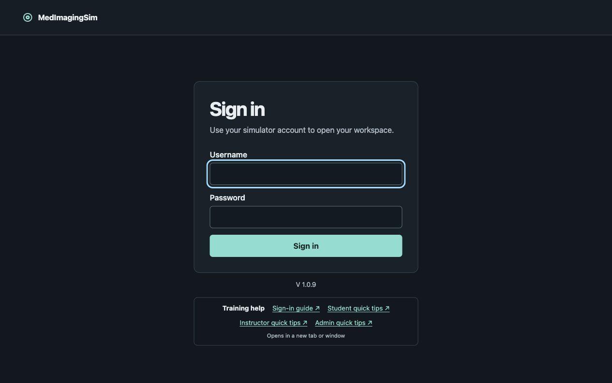

*Figure 1. Check the displayed build version before reporting a problem. The host's [LAN connection instructions](LAN_HOSTING.md#4-connect-a-tester) explain certificate trust.*

### Version numbering

The displayed version uses all three components. This release starts at **V 1.0.3**; successive delivered changes use **1.0.4**, **1.0.5**, and so on. After **1.0.9**, the next is **1.1.0**. The version below the sign-in box is the application version, while screenshot metadata retains the version at capture.

## Roles and navigation

| Action | Student | Instructor | Admin |
| --- | --- | --- | --- |
| Manual / Quick order | Own orders | Creates orders in institution | Creates orders in institution |
| Review, correct, return for information, schedule | Own orders | Institution's orders | Institution's orders |
| Practice scenarios | Available | Not shown | Available |
| RIS date filtering | Own exams | Institution's exams | Institution's exams |
| Patient link in RIS | Opens exam/screening | Opens scheduled intake review | Opens exam/screening |
| Reschedule before screening | Own exam | Unavailable | Institution's accessible exams |
| Safety screening and MRI acquisition | Own eligible exam | Unavailable | Institution's eligible exams |
| Instructor home | Unavailable | Available | Available |
| Assignment dispatch / grading / completed-view controls | Planned | Planned | Planned |

**Order queue** contains requests awaiting review and scheduling. **RIS worklist** contains scheduled exams for the selected date. **Instructor home** is the future submissions workspace. **Training help** links to the guide section for the screen and the signed-in role’s quick tips. The wordmark returns to Order queue. An admin is still scoped to the current institution; this is not a cross-institution superuser. Reviewing another user's order does not change its original owner.

## Review and schedule an incoming order

### Create an order

All creation paths produce a pending request. They do not immediately open screening or the MRI console.

| Entry path | Instructions | Expected result |
| --- | --- | --- |
| **Manual order** | Expand Manual order, enter the supplied fictional information, and select **Create order**. | An Order review page opens for the new request. Unavailable details can be left blank for an exercise. |
| **Quick order** | Select **Quick order** once. | A randomly generated order opens for review. Each order independently has an 80% chance of complete intake and 20% chance of one to three missing required fields. Small batches need not contain exactly that ratio. |
| **Practice scenarios** | As student/admin, expand Practice scenarios, select **Routine brain MRI** or **Implant review**, and select **Create scenario order**. | A prepared scenario enters the same review process. It still needs an appointment and completeness checks. |

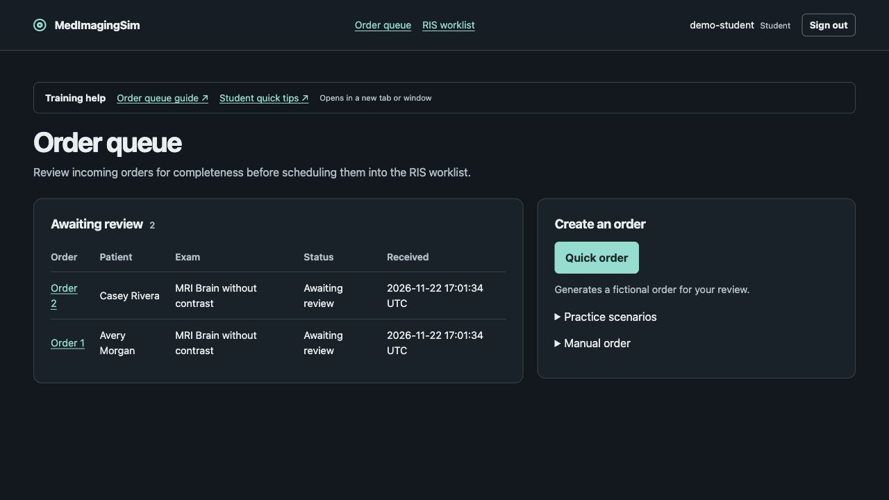

*Figure 2. Select the order number to review a request. A request is separate from its later RIS accession.*

### Check every required field

Open the order by its number and compare each field against the exercise information. A populated field can still contain a mistake: the application can check required presence and supported values, while you must check clinical and demographic accuracy.

| Field | Required to schedule? | How to enter/review |
| --- | --- | --- |
| **First name** | Yes | Given name in its labeled field. Multipart names are supported. |
| **Last name** | Yes | Family name in its labeled field. Names display as First Last with one space; extra whitespace is normalized. Apostrophes, hyphens, and accented characters are supported. |
| **Patient ID / MRN** | Yes | Use the fictional identifier supplied for the exercise. |
| **Date of birth** | Yes | Use the date picker or its displayed date format. The date must be real, no earlier than 1900, and not in the future. |
| **Recorded sex** | Yes | Select Female, Male, Other, or Unknown as appropriate to the exercise. Blank / Not supplied is missing information. |
| **Requested exam** | Yes | Select the supported **MRI Brain without contrast** exam. |
| **Reason for exam** | Yes | Enter the indication supplied for the exercise. |
| **Clinical history** | Optional for initial completeness | Preserve relevant context. Use it when deciding screening answers. |

For example, enter first name `Avery` and last name `Morgan`; the display becomes `Avery Morgan`. An older queued order with one combined name shows it for reference and requires confirmation of both name fields before scheduling. Previously scheduled patient names remain saved as originally entered.

### Record missing information and corrections

1. Identify missing or incorrect information before checking completeness.
2. If you need follow-up, select **Return for missing information**. The request stays in the queue with **Needs information** status. This records a decision; it does not send a message to another user or automatically populate the missing fields.
3. Obtain the correct fictional details from the exercise/instructor. Reopen the request, correct the fields, and select **Save corrections**. Do not invent information merely to make the form pass.
4. Read **Review history** to verify your action, the missing fields, and the reviewer/time. Its timestamps are labeled UTC, whereas appointments use the displayed institution timezone.
5. Expand **Original order as received** to compare the incoming details with corrections. Correcting the order preserves that original snapshot.

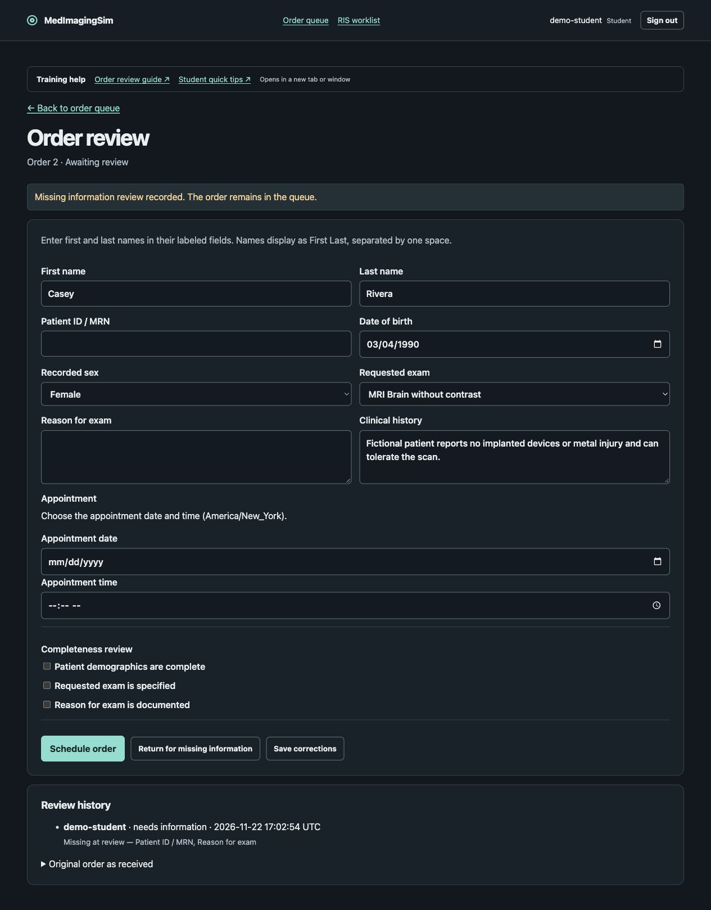

*Figure 3. The example request lacks its MRN and indication. Returning it for information records that decision without scheduling it.*

### Choose an appointment and schedule

1. Check demographics, exam, and reason for completeness and accuracy.
2. Enter an explicit **Appointment date** and **Appointment time**. These are required even for complete quick orders and practice scenarios. Use the institution timezone shown next to Appointment: **America/New_York** on the test host. Your browser may display a 12-hour or 24-hour time control.
3. Check **Patient demographics are complete**, **Requested exam is specified**, and **Reason for exam is documented** only after verifying them.
4. Select **Schedule order**. Missing information, an invalid date/time, or unchecked completeness categories block scheduling and record the attempt. Review the message, correct the problem, and recheck the confirmations.
5. Successful scheduling returns to **Order queue**. The request disappears from its pending list and receives a stable `SIM-…` accession in RIS. Screening does not open automatically.
6. Select **RIS worklist** separately when you are ready to take an exam. If scheduled for another date, choose that date in RIS to see it.

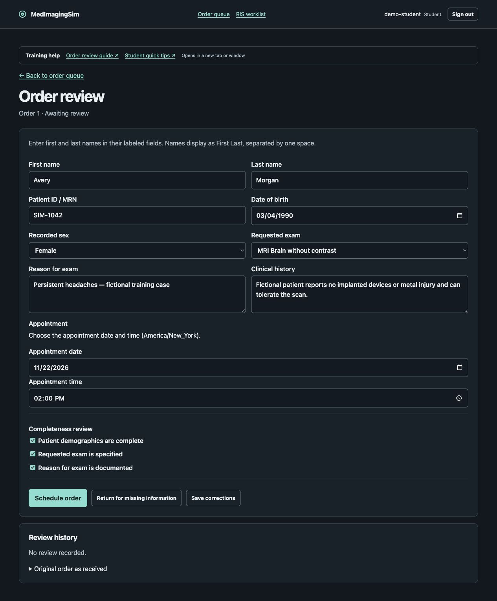

*Figure 4. The sample date is illustrative. Choose the actual intended date for your exercise; an accidentally future date will prevent screening and scanning.*

If a message says someone else changed the request, reopen it to load the latest revision, review the new details, and retry. Instructors/admins scheduling a student's request preserve the student's ownership. Do not recreate the request simply because it is absent from today's RIS view.

## Find and screen an exam in RIS

### Find the correct date and patient

1. Select **RIS worklist**. It defaults to today in the displayed institution timezone and sorts exams by appointment time.
2. To inspect another day, set **Appointment date** and select **Show appointments**. Select **Today** to return to today.
3. Confirm patient, exam, appointment date/time, accession, and status before opening it. Students see their own exams; instructor/admin views include an **Owner** column.
4. As student/admin, select the patient name to open the exam. As instructor, the same link opens its scheduled intake review.

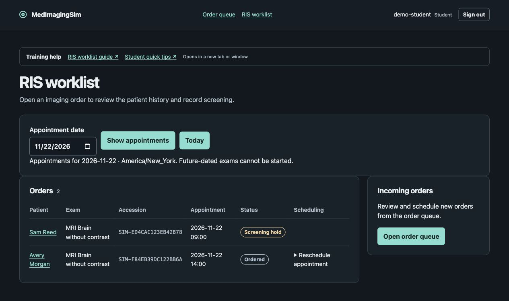

*Figure 5. The date filter controls which scheduled exams appear. A future exam or an older saved exam may be on a different date.*

Existing exams created before appointment scheduling were assigned their original creation date/time in the institution timezone. Look at that date to find them; saved screening and scans remain attached to their accession.

### Correct an appointment before screening

1. Find the exam using the date filter. A future appointment is visible on its future date but cannot start screening or acquisition, including through a direct URL.
2. Expand **Reschedule appointment** in the row or order page. The correction date defaults to today; the time starts with the existing appointment time.
3. Confirm the intended date **and** time, then select **Save appointment**. Changing a field alone does not save it.
4. The worklist opens on the new date. Confirm the exam appears once there. Open its order page and expand **Appointment history** to review who changed it and the old/new appointment.
5. Rescheduling is unavailable once screening is submitted. If the appointment changed concurrently, reopen the current order before retrying. Students correct their own exams; admins can correct eligible exams in their institution. Instructors do not have this action.

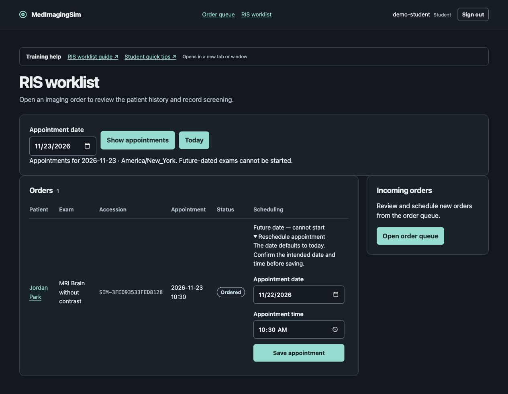

*Figure 6. The filter still shows the original future day, while the correction form defaults to today. Verify both before selecting Save appointment.*

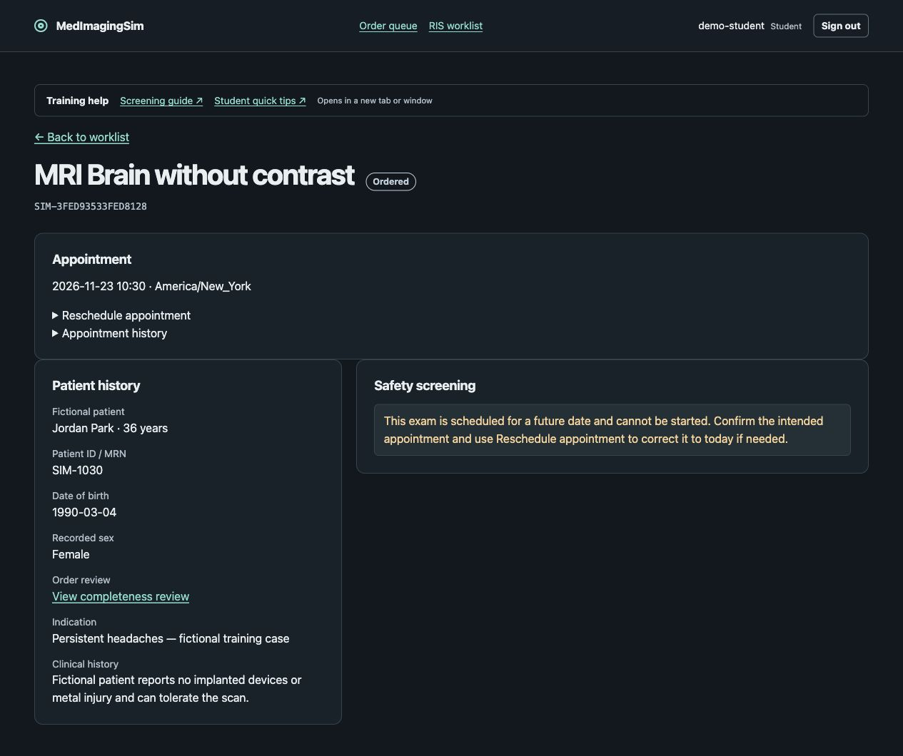

*Figure 7. Appointments later today may be taken today. The current block applies to future calendar dates, not later times on today's schedule.*

### Submit screening

1. From RIS, open the intended patient whose appointment is not on a future date.
2. Read **Patient history**, including the indication, clinical history, MRN, DOB, and recorded sex. Confirm the accession.
3. Under **Safety screening**, answer all three questions: implanted devices/hardware, metal fragments/injury, and tolerance concerns. Select **No**, **Yes**, or **Unsure** using the exercise information.
4. Select **Submit screening**. Submitted answers become read-only. This release does not provide a hold-clearance or screening-edit workflow.
5. Check the result below. A clear result provides **Open MRI console**; a held case remains blocked. Ask the instructor how to continue the exercise rather than changing the story to get a clear result.

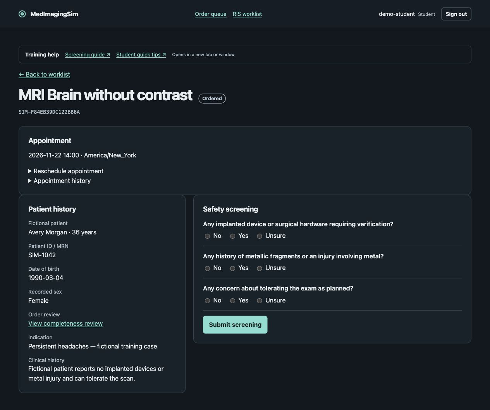

| Status | Meaning and next step |
| --- | --- |
| **Ordered** | Scheduled and awaiting screening. A future appointment still cannot start. |
| **Screening hold** | At least one answer was Yes or Unsure. The MRI console is unavailable; stop and discuss the case. |
| **Ready for console** | All three screening answers were No. Select Open MRI console if the date is eligible. |

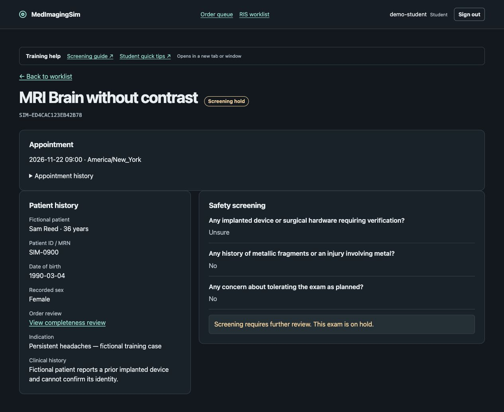

*Figure 8. The hold is an expected training outcome. For the alternative clear path, use the Routine brain MRI exercise and answer from that case's history.*

### Try both screening outcomes

For a clear practice case, create **Routine brain MRI**, review and schedule it for today, then use its history to complete screening. For the hold case, use **Implant review** and reflect the uncertain implant information. Create separate cases for different exercises because submitted screening cannot be reset in this version.

## Plan and run an MRI scan

1. Open an order marked **Ready for console** and select **Open MRI console**. Check **Patient and exam** in the upper left. Confirm the patient, exam, and accession match your RIS order. Select **Back to RIS order** to return at any time.
2. Across the top, under **Positioning localizers**, inspect the axial, coronal, and sagittal views. The orientation letters label the image edges. The cyan overlay shows the projected field of view and slice stack on all three views. An amber overlay marks the saturation band when enabled. Change a planning control and watch the overlay update.
3. In the lower-left **Protocol and sequences** panel, choose a **Preset**. Use **Scan parameters** below the localizers to set geometry, timing, sampling and encoding, or spatial saturation. Choose the preset before editing timing because choosing a new preset reloads its timing defaults.
4. Select **Run scan**. The newest series opens automatically in **Series preview**, beside the parameters on a wide screen. Open **Series details** to confirm that its geometry and timing match the plan you entered.

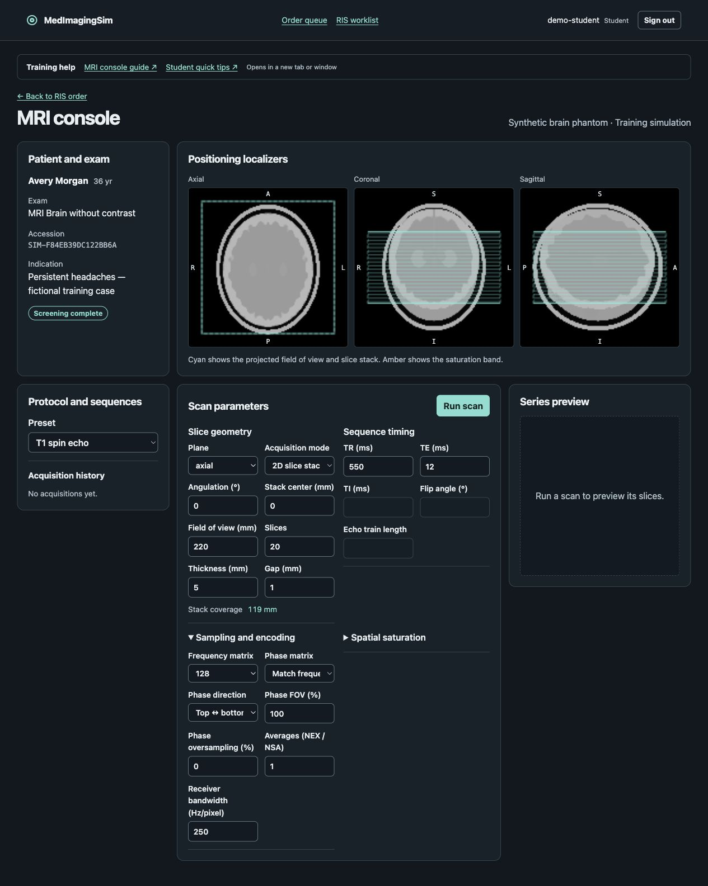

*Figure 9. On a wide display, patient/exam and sequence information are on the left; localizers are above parameters and the preview. Smaller displays stack these areas vertically.*

### Slice geometry controls

| Control | What it changes |
| --- | --- |
| **Acquisition mode** | Use a 2D slice stack or select **3D slab (GRE)** after choosing **Spoiled gradient echo**. A 3D slab uses contiguous partitions, so the gap is set to zero. |
| **Plane** | Sets the base orientation to axial, coronal, or sagittal. |
| **Angulation (°)** | Tilts the slice stack relative to the chosen plane. |
| **Stack center (mm)** | Shifts the stack along its slice direction. Check the perpendicular localizers for the shift. |
| **Field of view (mm)** | Sets the readout field of view. **Phase FOV (%)** can make the other dimension smaller. |
| **Slices** | Sets how many images the scan acquires. |
| **Thickness (mm)** | Sets slice thickness. |
| **Gap (mm)** | Sets the spacing between adjacent slice edges. |
| **Stack coverage** | Shows the total span. For example, 20 slices at 5 mm with a 1 mm gap span 119 mm. |

### Pulse sequence controls

| Control | What it changes |
| --- | --- |
| **Preset** | Loads **T1 spin echo**, **T2 spin echo**, **PD spin echo**, **Fluid-suppressed inversion recovery**, **Spoiled gradient echo**, or **T2 fast spin echo**. |
| **TR (ms)** and **TE (ms)** | Set repetition and echo timing for the simulated signal. |
| **TI (ms)** | Sets inversion timing. This field is enabled when you select the inversion-recovery preset. |
| **Flip angle (°)** | Changes signal in the spoiled GRE preset. |
| **Echo train length** | Changes the estimated time for **T2 fast spin echo**. The simulator uses an idealized image signal for this preset. |

### Sampling, encoding, and spatial saturation

| Control | What it changes |
| --- | --- |
| **Frequency matrix** and **Phase matrix** | Set sample counts along the readout and phase directions. Choose **Match frequency** for the same count in both directions. |
| **Phase direction** | Sets vertical or horizontal encoding in the slice view. The readout direction follows the other axis. Phase wrap follows the phase axis. |
| **Phase FOV (%)** | Sets the phase field of view as a percentage of the readout FOV. Reducing it can make anatomy wrap into the displayed field. |
| **Phase oversampling (%)** | Expands the encoded phase field while keeping the displayed field the same. It can reduce wrap and increases the estimated acquisition time. |
| **Averages (NEX / NSA)** | More averages reduce simulated noise and increase the estimated acquisition time. |
| **Receiver bandwidth (Hz/pixel)** | Higher bandwidth increases noise in this training model. |
| **Saturation band** | Choose its direction, then set **Band center** and **Band thickness**. Check the amber marks on the localizers. The band reduces signal in the selected region. |

### Supported values and validation

These are the limits of the current training model, rather than a specification for a physical scanner. The controls and server validate submitted values.

| Control | Supported values / rule |
| --- | --- |
| Angulation | −45° to +45°, 1° steps. |
| Stack center | −80 to +80 mm, 1 mm steps; combined center and coverage must fit the localizer. |
| Field of view | 100–260 mm, 1 mm steps. |
| Slices | 1–24, whole numbers. |
| Thickness | 1–12 mm, 0.5 mm steps. |
| Gap | 0–6 mm, 0.5 mm steps; zero and read-only in 3D mode. |
| TR | 200–10,000 ms for non-GRE; 6–10,000 ms for GRE, whole milliseconds. |
| TE | 5–250 ms, whole milliseconds, strictly shorter than TR. |
| TI | 50–4,500 ms for inversion recovery; TI + TE must be shorter than TR. |
| Flip angle | 1–90°, whole degrees, for spoiled GRE. |
| Echo train length | 2–32, whole numbers, for fast spin echo. |
| Frequency/phase matrices | 64, 96, or 128; phase can Match frequency. |
| Phase FOV / oversampling | 50–100% / 0–100%, whole percentages. |
| Averages | 1–8, whole numbers. |
| Receiver bandwidth | 80–800 Hz/pixel, 10 Hz/pixel steps. |
| Band center / thickness | −130 to +130 mm / 5–70 mm, whole millimeters, when saturation is enabled. |
| Window width / level | Width 1–255; level 0–255, whole numbers. |

All geometry settings interact. For example, coverage is slices × thickness + (slices − 1) × gap; changing one field can make an otherwise valid plan too large. A disabled field is not currently applicable to the selected preset or mode. Review the validation message before rerunning.

For parameter coverage and upcoming controls, see the [MRI console parameter inventory](MRI_CONSOLE_COVERAGE.md).

## Review, repeat, and select a series

1. In **Series preview**, use the **Slice** slider to step through the series. Compare images at the same slice number when geometry is unchanged.
2. Adjust **Window width** and **Window level** beside the image. Width controls the displayed intensity range and level shifts its midpoint. The preview updates as you change valid values.
3. To repeat a scan, change a setting under **Scan parameters** and select **Run scan** again. Each run appears in **Acquisition history**. To preview an earlier run, drag its series row onto **Series preview**. You can also click the row or press **Enter** while it has keyboard focus. Your current scan settings stay in place. Open **Series details** to inspect the displayed series metadata.
4. To prepare a series for PACS, open that series, set the desired window and level, and select **Save PACS selection**. Confirm the **Selected for PACS** notice lists the intended series number and values. Saving a different series replaces the saved selection for this exam. Each scan remains in the history.
5. Reopen the exam and check the **Selected for PACS** notice. A fresh console visit previews the latest acquisition. Select the saved series from history to verify its stored window and level. This version prepares the selection. PACS transfer, exam completion, and instructor review are scheduled for Milestone 3.

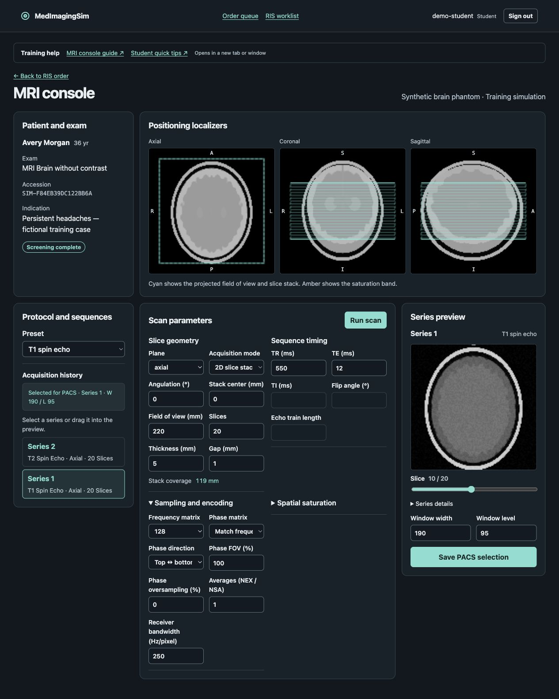

*Figure 10. The saved PACS selection names the series explicitly. The previewed series and the current scan plan are different concepts.*

Changing preview using a series link or drop keeps an unsent plan in the current browser page. A reload, leaving the console, or saving the PACS selection can rebuild the plan from the displayed series. Recheck the preset and parameters before the next run; unacquired edits are not a saved protocol. Series numbers identify saved acquisitions and may skip numbers across different exams.

### Practice comparing contrast and preserving a repeat scan

1. Start with **Routine brain MRI** cleared by screening. Run **T1 spin echo** with the default geometry and note the series number.
2. Keep the geometry and matrix the same. Select **T2 spin echo** and run another scan.
3. Open each series in **Acquisition history** and compare the same slice with the same window and level. Pick a slice through the simulated ventricles near the middle of the stack. Fluid appears darker on T1 and brighter on T2 in the training phantom.
4. Reopen the first series, set a different window and level, and save it for PACS. Return to the console from RIS and verify the second series previews by default. Drag the first series into **Series preview** and confirm its saved window and level. Compare the values under **Scan parameters** before and after the drop to confirm the plan stays in place.

## Instructor instructions

### Review intake work within your institution

1. Sign in using an instructor account and confirm **Instructor** in the header. Your first screen is **Order queue**.
2. Identify the request using **Created by**, patient, exam, and status. Only orders in the current institution are visible.
3. Open its order number. Review the current fields and **Review history** before editing; the history shows what a student marked missing, corrected, or attempted to schedule.
4. Expand **Original order as received** to compare the incoming request. Use the exercise requirements to judge accuracy, not just whether required fields are populated.
5. If the exercise calls for instructor intervention, correct or return the request using the shared review steps. Changes are attributed to your account. Scheduling the student's order keeps its original owner.
6. After scheduling, open **RIS worklist**, choose its appointment date, and select its patient to inspect the scheduled intake review. Instructors can also create their own manual or quick orders; **Practice scenarios** is not shown to this role.

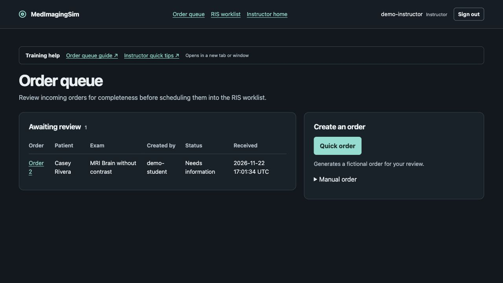

*Figure 11. The creator column supports finding a student's pending work without changing ownership.*

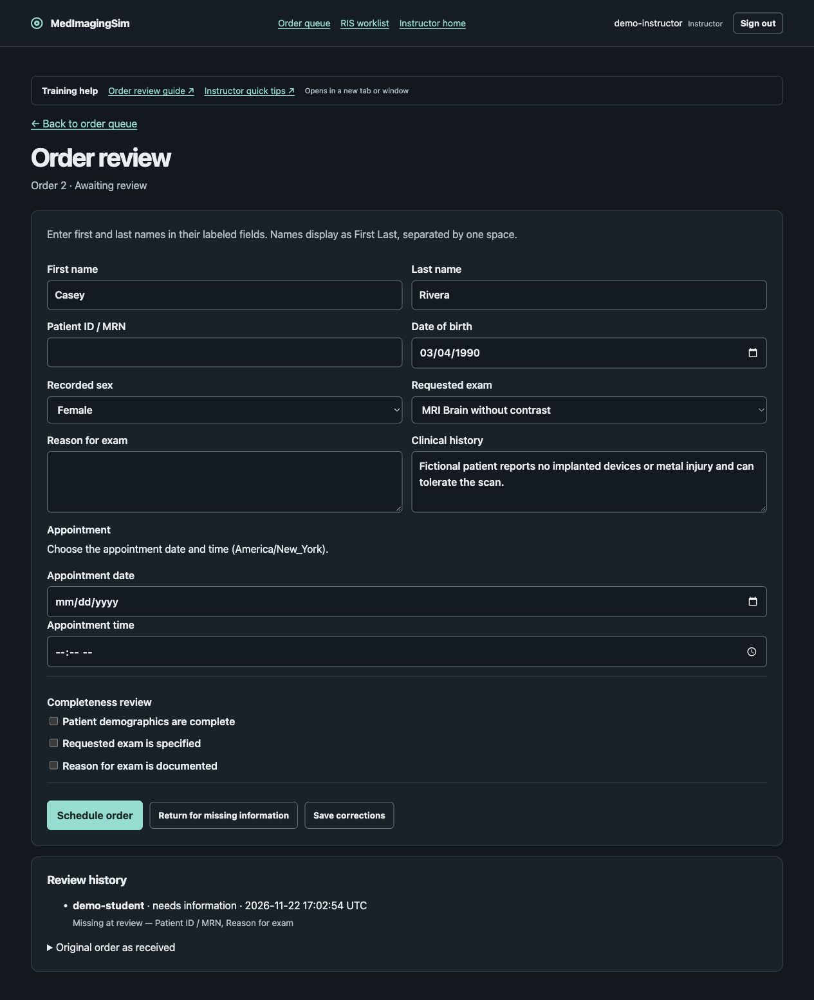

*Figure 12. Review history is the available intake assessment evidence. There is no automatic rubric score for these decisions yet.*

### Use Instructor home and understand current limits

Select **Instructor home**. **Submissions** currently shows **No submissions to review**. Assignment dispatch, cohort management, grading, and acquisition review are planned. There is no student console access under the instructor role. Ask an admin to demonstrate console behavior or observe the student's own screen when appropriate; do not assume an empty submissions page means their saved scans are gone.

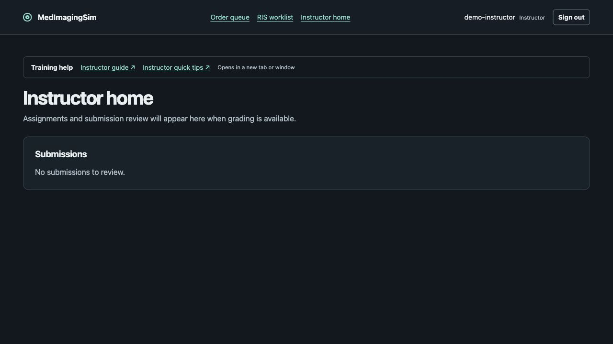

*Figure 13. The placeholder accurately describes the current feature boundary.*

### Run a teaching session with the available tools

Before the session, give learners their account details, test-server address, exercise patient data, intended appointment date, and desired stopping point. Ask them to note their accession and any series numbers. For an intake exercise, inspect the original request and review history. For acquisition practice, observe the student's console and have them explain the selected series and parameter changes. Formal assignment dispatch and scoring will be added later; do not distribute the source training manuals' exercises or answer keys as our simulator content.

## Administrator instructions

### Work across the institution

1. Sign in as admin and verify **Admin** in the header.
2. Use **Order queue** to find requests from the institution. Check **Created by** before intervening.
3. Use **RIS worklist** and the date filter. The **Owner** column identifies whose exam you are opening.
4. Open a patient to inspect the order and, where eligible, reschedule, submit screening, enter the console, run scans, or save a PACS selection. These actions affect the real saved training case and are attributed to the account performing them.
5. Select **Instructor home** to verify that workspace. It is still the same session; use **Sign out** to switch to a dedicated student or instructor test account.

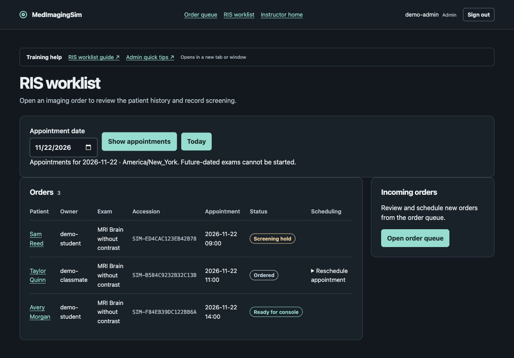

*Figure 14. Admin access spans users inside the current institution. It does not authorize access to other institutions.*

### Provision accounts as a host operator

Account provisioning is currently a server command, not an in-app admin screen. If you also operate the host, use the application database configured for that environment. From the ThinkPad SSH session, follow the [hosting runbook](LAN_HOSTING.md) for the persistent database and current release. On a local development checkout, the command is:

```sh
npm run create-user -- student1 student
npm run create-user -- instructor1 instructor
npm run create-user -- admin1 admin
```

The command prints a generated password. Supply it privately to the intended user. Valid roles are `student`, `instructor`, and `admin`; usernames use lowercase letters, numbers, dots, underscores, or hyphens and must be 3–40 characters. There is no in-app account-list, role-edit, password-reset, or institution-management screen. Do not create users against a temporary documentation database expecting them on the live host.

### Verify a new tester build

1. Confirm the intended Git commit is deployed on the ThinkPad using the runbook; a VS Code push starts the update process but does not prove success.
2. From a separate LAN device, open the sign-in page and confirm the expected version below the box.
3. Sign in with each dedicated role and verify the changed workflow and role boundaries.
4. Confirm an existing order, its screening, saved acquisitions, and saved PACS selection survive the update. Check older appointment dates if the order is absent today.
5. Record commit, observed version, device/browser, result, and any problem. Backups, deployment status, services, and lid/power behavior belong to the [LAN hosting runbook](LAN_HOSTING.md).

## Verify the instructor and administrator workspaces

Use this short acceptance exercise after setup or a role-related update:

- Student: create, review, and schedule a fictional case; open it from RIS; scan if cleared. Confirm a classmate's exam is absent from the student account.
- Instructor: find the student's pending request and its review history; inspect a scheduled intake through the RIS patient link. Confirm Instructor home is available and the MRI console is not an instructor action.
- Admin: find exams from two users in the same institution, open an eligible one, and verify both the console and Instructor home. Check the Owner column before any change.

## Troubleshoot an issue

| What you see | What to do |
| --- | --- |
| Site does not open | Confirm the exact HTTPS address including port 8443 and local-network access. Ask the host operator to check ThinkPad power, Ethernet, Caddy, and the application service. |
| Certificate warning | Follow the host's [certificate-trust instructions](LAN_HOSTING.md#4-connect-a-tester) for that device before testing. |
| Sign-in fields clear / sign-in fails | Re-enter the supplied username/password, confirm the URL/version, and contact the host if it repeats. There is no browser password-reset action. A saved password may refer to another server or user. |
| Too many sign-in attempts | Pause before retrying. Repeated attempts for one account are throttled. |
| Wrong version | Reload after the operator verifies deployment. Provide the version shown below the sign-in panel and the expected version. |
| Pending request missing from RIS | It must first be reviewed and scheduled. Scheduling returns to the queue; it does not open screening. |
| Scheduled exam absent today | Select its actual appointment date. Also confirm account/owner/institution. Older exams may be on their original creation date. |
| Required information is missing | Correct the stated fields, choose a valid appointment date/time, and check all three completeness categories after review. |
| Someone else changed the order/appointment | Reopen it to load the current values, then retry after checking them. Do not blindly repeat stale edits. |
| Future-dated exam cannot start | Correct the appointment only if its date is wrong, or wait for its intended day. A future-date warning is not a software failure. |
| Reschedule option is absent | Screening has already been submitted, the role does not permit it, or the exam is otherwise ineligible. The current release cannot reschedule a screened case. |
| Screening hold / no console button | Review the read-only answers. Yes or Unsure causes a hold. There is no hold-release control in this release. |
| Instructor cannot open the console | Expected role boundary. Use intake history or observe the learner; admin can perform eligible console workflows. |
| TE/timing or coverage validation | Keep TE shorter than TR and TI + TE shorter than TR for inversion recovery. Reduce coverage or move the center toward zero if the stack exceeds the localizer. |
| A field is disabled | Its preset/mode does not use it. Choose the appropriate preset; 3D is available for spoiled GRE. |
| Scanner is busy | Wait briefly and select Run scan again. Check that the intended settings are still present. |
| Preview image fails to load | Reload, sign in again if needed, and reopen the same accession. Recheck unsaved plan settings. |
| Touch device cannot drag series | Tap the acquisition-history link instead. Keyboard users can focus it and press Enter. |
| Preview and scan plan differ | An earlier series can be previewed while another plan is being edited. Read Series details for the acquired settings; check Scan parameters before running again. |
| Changes disappeared after leaving the console | Submitted scans persist; unacquired plan edits are not saved as a reusable protocol. Reloading can rebuild controls from an acquired series. |
| PACS selection seems absent or different | Check the same account/accession and the Selected for PACS notice. Saving a new selection replaces the single saved selection for this exam. |
| No grading or completed-exam controls | Those features are planned. Instructor home currently contains a submissions placeholder. |

### Report a reproducible problem

Give the instructor/host: application version, role, device/browser, date filter and displayed timezone, accession or request number, the exact steps, expected result, actual result, and the visible message. Attach a screenshot of the relevant simulator screen. Do not include passwords or unrelated personal information. State whether the problem survives a reload. Use a separate exercise case if a saved screening response would otherwise need to be changed.

## Glossary

| Term | Meaning in this version |
| --- | --- |
| Order queue / request | Incoming fictional request awaiting completeness review and scheduling. |
| RIS | Radiology Information System workspace containing scheduled exams. |
| Accession | Stable SIM identifier linking an exam and its acquisitions. |
| Appointment | The exam's scheduled date/time in its institution timezone. |
| Screening hold | Saved screening outcome that blocks console access. |
| Preset | Initial sequence-family and timing choices for a scan plan. |
| Localizer | Reference view used to inspect the planned geometry. |
| Acquisition / series | Saved scan result with immutable images and acquisition metadata. |
| Window/level | Presentation settings for displaying saved image intensities. |
| PACS selection | The one series plus presentation selected for later PACS handoff; it is not a completed transfer. |

## Current limits and planned work

This release supports standalone sign-in, manual/quick/scenario orders, intake review history, dated scheduling and rescheduling, RIS date filters, three screening questions, a synthetic brain MRI console, repeat acquisitions, preview interaction, and a saved series/presentation selection.

Planned capabilities include scanner/room availability and resource conflicts; instructor-selectable isolated/shared cohort schedules; separate appointment/exam progress and explicit arrival/start/end; a Completed/Recent view; full PACS routing, assignment dispatch, grading, and instructor acquisition review; and institutional identity/LMS integration. CT remains deferred until after the MRI release and institutional integration. These planned items do not appear as working controls today.

## Functional references and documentation maintenance

The five supplied reference documents guide workflow understanding. Our interface, implementation, examples, and screenshots are original. The [topic index](REFERENCE_INDEX.md) routes development tasks to relevant pages; the [decision log](REFERENCE_WORKFLOWS.md) distinguishes confirmed targets from unresolved requirements. The guide documents the actual simulator, even where a source product offers more features.

This guide, all three tip sheets, printable copies, and affected screenshots are maintained with each delivered change. [DOCUMENTATION_MAINTENANCE.md](DOCUMENTATION_MAINTENANCE.md) records how to verify and refresh them. Screenshots were captured on November 22, 2026 against V 1.0.3 using fictional demo accounts and patients; they are not captures from the live ThinkPad. LAN deployment verification is recorded separately in the milestone handoff.
