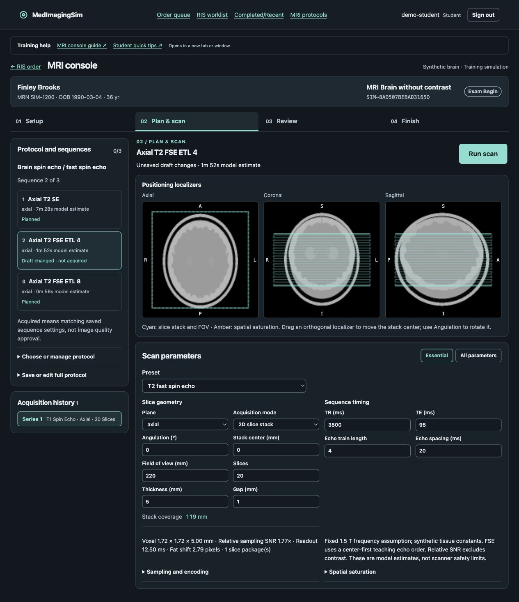
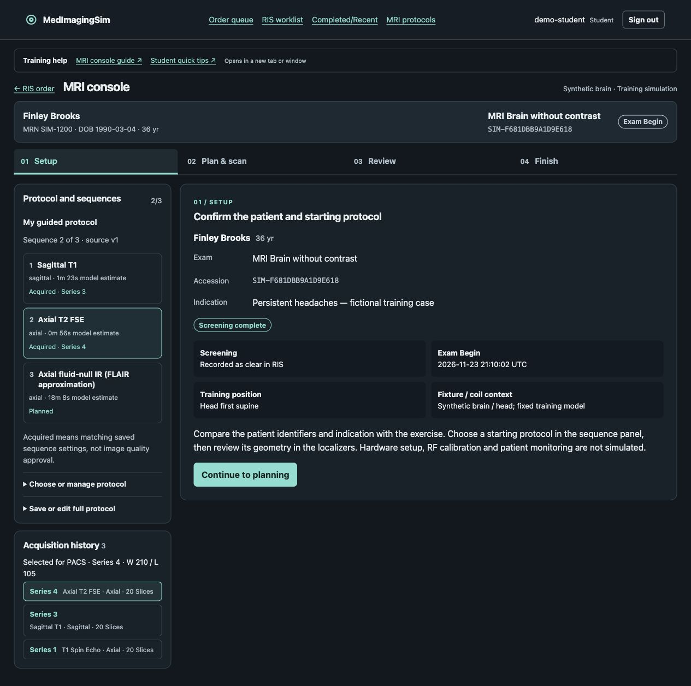
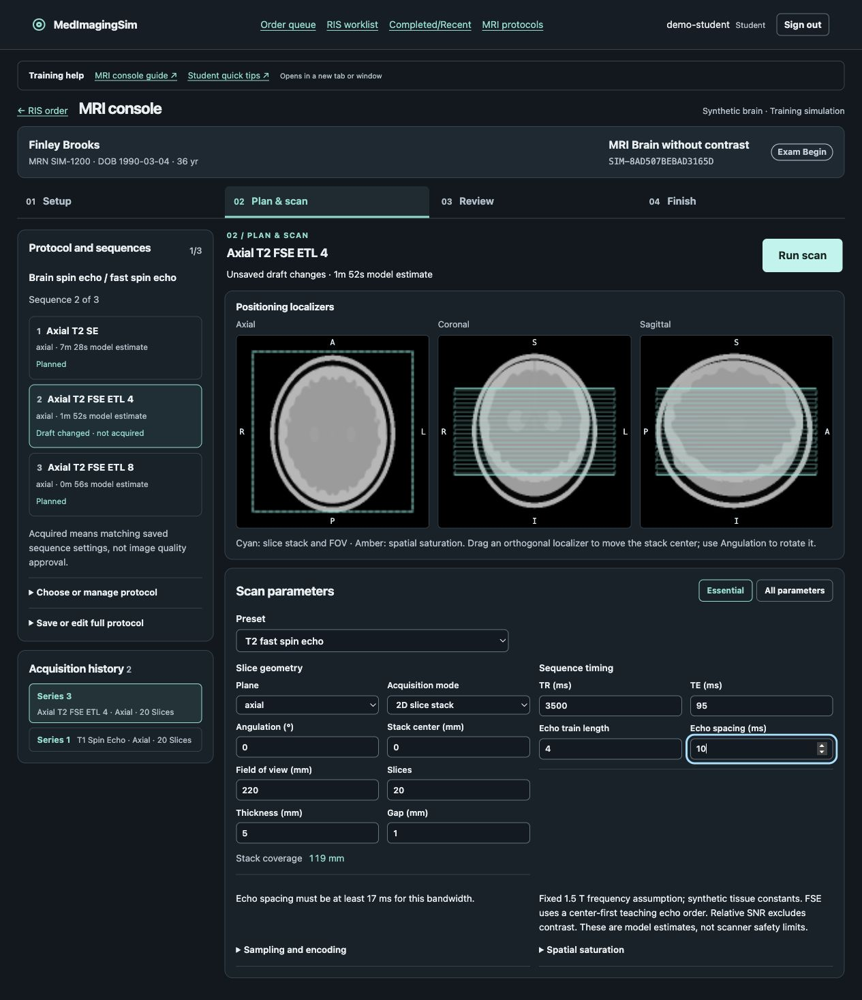
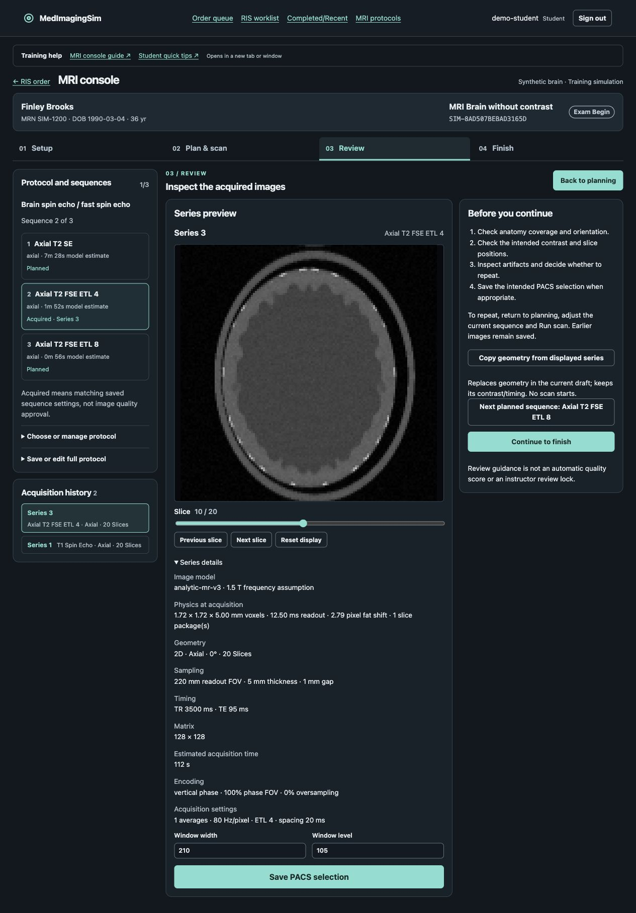
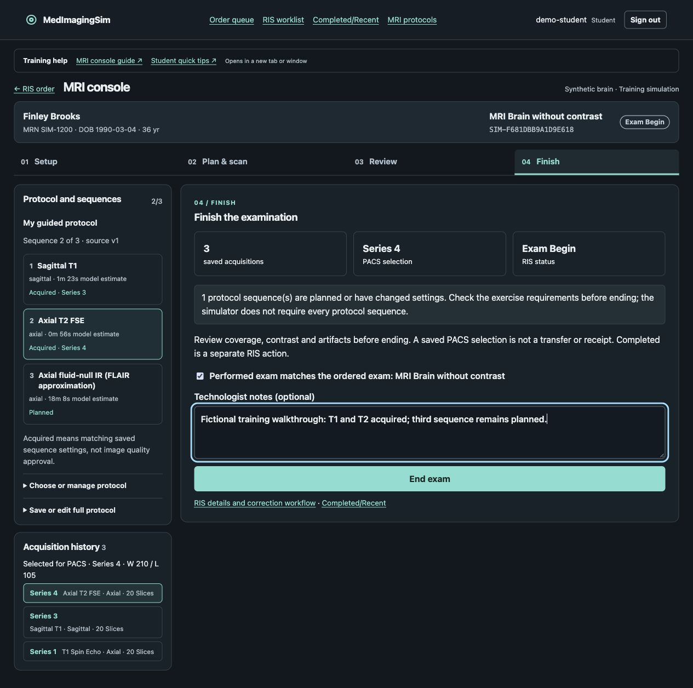
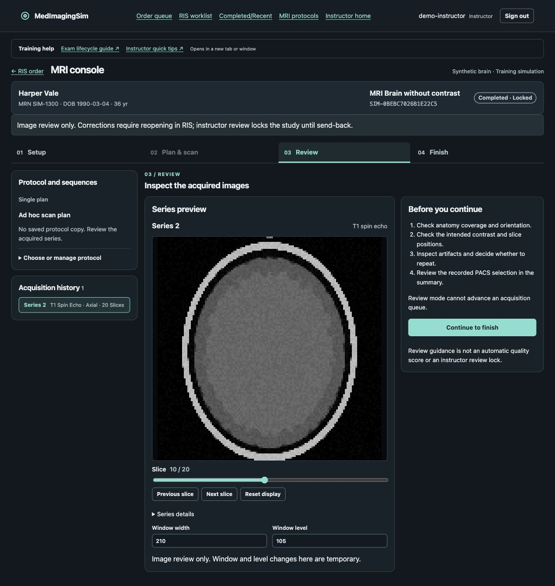

# MedImagingSim user guide

**Guide version: V 1.1.0 · Locally checked November 23, 2026; guided-console browser walkthrough passed; print/LAN verification pending · MRI training release**

This guide covers the working simulator, with separate instructions for students, instructors, and administrators. Use fictional patients and the synthetic brain phantom. V 1.1.0 sign-in and physics planning/review screenshots use a disposable fictional-data environment. Unchanged Setup/Finish/locked-review workflow examples retain V 1.0.9 captures; their original capture versions remain in the manifest. Earlier dictionary/planning captures are pending refresh and omitted. Local parameter/image tests and the physics browser walkthrough are recorded in the milestone handoff; full print and ThinkPad/LAN checks remain pending.

**Release status:** these instructions describe the local V 1.1.0 code. The user is handling the pending commit/push; the ThinkPad deployment and live version have not been verified. The updated physics controls passed a local browser walkthrough. Other screen refresh, print-layout and live-host checks remain pending.

**Internal test server:** [https://192.168.0.180:8443/sign-in](https://192.168.0.180:8443/sign-in). Connect to the same local network and complete the host's certificate trust setup first. The ThinkPad hosts the tester build; your Mac is a client and development machine.

**Screenshot status:** current sign-in and protocol examples appear below. Other workflow images remain refresh-pending.

## Choose your instructions

| You need | Start here |
| --- | --- |
| Full student workflow | [Sign in](#open-the-simulator-and-sign-in), then [review an order](#review-and-schedule-an-incoming-order). |
| A short checklist beside the console | [Student quick tips](quick-start/STUDENT.md). |
| Reviewing student intake decisions | [Instructor instructions](#instructor-instructions) and [instructor quick tips](quick-start/INSTRUCTOR.md). |
| Supporting users or validating a build | [Administrator instructions](#administrator-instructions) and [administrator quick tips](quick-start/ADMIN.md). |
| Browser/print-friendly copies | [Full guide](print/USER_GUIDE.html), [student](print/STUDENT.html), [instructor](print/INSTRUCTOR.html), [admin](print/ADMIN.html). Open the HTML file in a browser and use Print or Save as PDF. |
| An error or missing exam | [Troubleshooting](#troubleshoot-an-issue). |

Contents: [Console workflow](#use-the-guided-console-workspace) · [Access](#open-the-simulator-and-sign-in) · [Roles](#roles-and-navigation) · [Order review](#review-and-schedule-an-incoming-order) · [RIS and dates](#find-and-screen-an-exam-in-ris) · [MRI controls](#plan-and-run-an-mri-scan) · [Series review](#review-repeat-and-select-a-series) · [Exam lifecycle](#end-complete-review-and-correct-an-exam) · [Instructor](#instructor-instructions) · [Admin](#administrator-instructions) · [Troubleshooting](#troubleshoot-an-issue) · [Glossary](#glossary) · [Planned features](#current-limits-and-planned-work)

## Open the simulator and sign in

**Before you start:** obtain your account and password from the host/instructor, confirm which role you should use, and connect to the tester network. The app has no self-registration or password-reset screen.

1. Open the internal test address above in Safari, Chrome, or your device's browser. For development on the same Mac that runs the server, use [http://127.0.0.1:3000/sign-in](http://127.0.0.1:3000/sign-in). Do not use localhost to reach the ThinkPad from another device.
2. Check the version centered **below** the sign-in box. For this guide it is **V 1.1.0**. Tell the host if the deployed version differs. Reload after the host confirms an update; a completed local edit is not evidence of deployment.
3. Enter **Username**, then **Password**, and select **Sign in**. Passwords are case-sensitive. Use your supplied account rather than a name shown in a screenshot.
4. Confirm the account name and role in the top-right header. Successful sign-in opens **Order queue** for all current roles.
5. Use **Training help** on the screen to open the relevant guide section or your role's quick tips. The sign-in page offers tips for all three roles. Each simulator help link requests a new tab/window, leaving the current workflow open; browser preferences decide which. If a browser blocks it, allow the user-initiated opening or use its Open Link in New Tab action. The guide and screenshots are delivered by this simulator, so the ThinkPad needs the current documentation files in the release.
6. Select **Sign out** before switching roles or leaving a shared device. If your session expires, sign in again and reopen the saved order. The app preserves submitted orders, screening, scans, and PACS selection; unsaved field edits may be lost.


### Version numbering

The displayed version uses all three components. The numbering scheme started at **V 1.0.3**. This release is **V 1.1.0**; the next delivered change is **1.1.1**. The previous **1.0.9** rolled to **1.1.0**. The version below the sign-in box is the application version, while screenshot metadata retains the version at capture.

## Roles and navigation

| Action | Student | Instructor | Admin |
| --- | --- | --- | --- |
| Manual / Quick order | Own orders | Creates orders in institution | Creates orders in institution |
| Review, correct, return for information, schedule | Own orders | Institution's orders | Institution's orders |
| Practice scenarios | Available | Not shown | Available |
| RIS date filtering | Own exams | Institution's exams | Institution's exams |
| Patient link in RIS / Completed/Recent | Opens own exam | Opens institution exam; ended/completed study locks on opening | Opens institution exam |
| Reschedule before screening | Own exam | Unavailable | Institution's accessible exams |
| Safety screening / initial Begin exam | Own eligible exam | View only | Institution's eligible exams |
| MRI acquisition | Own begun exam | Begun correction cycle only | Institution's begun exams |
| End exam / Mark completed | Own eligible exam | End in a correction cycle; opening the ended study locks it, so completion must occur before review or after send-back | Institution's eligible exams |
| Reopen for correction before instructor review | Own ended/completed exam | Institution's ended/completed exams | Institution's ended/completed exams |
| Review lock on opening ended/completed study | Does not lock | Locks automatically | Does not lock |
| Send back for correction after review lock | Unavailable | Available within institution; reason required | Unavailable |
| Instructor home | Unavailable | Available | Available |
| Browse institution defaults and own personal MRI protocol versions | Available | Available | Available |
| Publish institution-default MRI protocol versions | Unavailable | Available | Available |
| Save personal protocol versions | Own versions | Own versions | Own versions |
| Assignment dispatch / grading | Planned | Planned | Planned |

**Order queue** contains requests at **Ordered**, with **Awaiting review** or **Needs information** as the review detail, awaiting scheduling. **RIS worklist** contains active scheduled exams for the selected appointment date. Unscheduled orders never appear there. **Completed/Recent** contains Exam End and Completed studies for the selected appointment date. Reopening returns a study to the active worklist. **Instructor home** links to study review; assignment dispatch and grading remain planned. **Training help** links to the guide section for the screen and the signed-in role’s quick tips. The wordmark returns to Order queue. An admin is still scoped to the current institution; this is not a cross-institution superuser. Reviewing another user's order does not change its original owner.

## Work independently in a class

The default configuration supports a classroom of 30 users with headroom; local request-handler and real localhost HTTP exercises passed with 60 independently signed-in students scheduling, screening, scanning and completing separate cases concurrently. This verifies the application workflow and ownership checks, not a guaranteed response time on the ThinkPad or every network.

1. Give every learner a separate student account. Students see and change their own cases; instructors/admins retain their institution-wide access. Reusing one account shares its saved cases even though each sign-in has a separate session token.
2. Use one signed-in account per browser profile or device. Tabs in the same profile share the sign-in cookie and are not separate identities. To practice different roles on one computer, use separate browser profiles or different browsers.
3. Work normally through Order queue, RIS worklist and the console. Multiple learners may save different cases and request scans at the same time. Their appointment times do not reserve a physical scanner: resource conflict management is still planned.
4. Scan calculations run in a bounded worker pool. With default settings, up to 64 scans can wait in addition to active workers. If **The scanner is busy** appears, wait briefly and select **Run scan** again; confirm the plan before retrying. This is temporary shared compute capacity, not another learner taking ownership of the case.
5. Sign out when finished. Signing out affects that browser session only; another learner's session is unaffected. Sessions normally last eight hours and saved work persists beyond sign-out and server restart. A server restart during a scan can interrupt that unfinished scan; reopen the saved case and retry.

## Review and schedule an incoming order

### Create an order

All creation paths produce a pending request. They do not immediately open screening or the MRI console.

| Entry path | Instructions | Expected result |
| --- | --- | --- |
| **Manual order** | Expand Manual order, enter the supplied fictional information, and select **Create order**. | An Order review page opens for the new request. Unavailable details can be left blank for an exercise. |
| **Quick order** | Select **Quick order** once. | A randomly generated order opens for review. Each order independently has an 80% chance of complete intake and 20% chance of one to three missing required fields. Small batches need not contain exactly that ratio. |
| **Practice scenarios** | As student/admin, expand Practice scenarios, select **Routine brain MRI** or **Implant review**, and select **Create scenario order**. | A prepared scenario enters the same review process. It still needs an appointment and completeness checks. |

### Check every required field

Open the order by its number and compare each field against the exercise information. A populated field can still contain a mistake: the application can check required presence and supported values, while you must check clinical and demographic accuracy.

| Field | Required to schedule? | How to enter/review |
| --- | --- | --- |
| **First name** | Yes | Given name in its labeled field. Multipart names are supported. |
| **Last name** | Yes | Family name in its labeled field. Names display as First Last with one space; extra whitespace is normalized. Apostrophes, hyphens, and accented characters are supported. |
| **Patient ID / MRN** | Yes | Use the fictional identifier supplied for the exercise. |
| **Date of birth** | Yes | Use the date picker or its displayed date format. The date must be real, no earlier than 1900, and not in the future. |
| **Recorded sex** | Yes | Select Female, Male, Other, or Unknown as appropriate to the exercise. Blank / Not supplied is missing information. |
| **Requested exam** | Yes | Select the supported **MRI Brain without contrast** exam. |
| **Reason for exam** | Yes | Enter the indication supplied for the exercise. |
| **Clinical history** | Optional for initial completeness | Preserve relevant context. Use it when deciding screening answers. |

For example, enter first name `Avery` and last name `Morgan`; the display becomes `Avery Morgan`. An older queued order with one combined name shows it for reference and requires confirmation of both name fields before scheduling. Previously scheduled patient names remain saved as originally entered.

### Record missing information and corrections

1. Identify missing or incorrect information before checking completeness.
2. If you need follow-up, select **Return for missing information**. The request stays in the queue with **Needs information** status. This records a decision; it does not send a message to another user or automatically populate the missing fields.
3. Obtain the correct fictional details from the exercise/instructor. Reopen the request, correct the fields, and select **Save corrections**. Do not invent information merely to make the form pass.
4. Read **Review history** to verify your action, the missing fields, and the reviewer/time. Its timestamps are labeled UTC, whereas appointments use the displayed institution timezone.
5. Expand **Original order as received** to compare the incoming details with corrections. Correcting the order preserves that original snapshot.

### Choose an appointment and schedule

1. Check demographics, exam, and reason for completeness and accuracy.
2. Enter an explicit **Appointment date** and **Appointment time**. These are required even for complete quick orders and practice scenarios. Use the institution timezone shown next to Appointment: **America/New_York** on the test host. Your browser may display a 12-hour or 24-hour time control.
3. Check **Patient demographics are complete**, **Requested exam is specified**, and **Reason for exam is documented** only after verifying them.
4. Select **Schedule order**. Missing information, an invalid date/time, or unchecked completeness categories block scheduling and record the attempt. Review the message, correct the problem, and recheck the confirmations.
5. Successful scheduling returns to **Order queue**. The request disappears from its pending list and receives a stable `SIM-…` accession in RIS. The RIS stage is **Scheduled**. Screening does not open automatically.
6. Select **RIS worklist** separately when you are ready to take an exam. If scheduled for another date, choose that date in RIS to see it.

If a message says someone else changed the request, reopen it to load the latest revision, review the new details, and retry. Instructors/admins scheduling a student's request preserve the student's ownership. Do not recreate the request simply because it is absent from today's RIS view.

## Find and screen an exam in RIS

### Find the correct date and patient

1. Select **RIS worklist**. It defaults to today in the displayed institution timezone and sorts exams by appointment time.
2. To inspect another day, choose **Appointment date**; the list refreshes automatically when a valid date is selected. No submit button is needed. Select **Today** to return to today.
3. Confirm patient, MRN, exam, appointment date/time, accession, and status before opening it. The **MRN** column shows the Patient ID / MRN saved at intake; older exams with no saved identifier display **Not supplied**. Students see their own exams; instructor/admin views include an **Owner** column.
4. Select the patient name to open the exam and its **Exam workflow**. The **View completeness review** link opens its intake evidence. Instructors can inspect active exams; opening an ended/completed study locks it automatically.
5. If an exam has ended, use **Completed/Recent** and choose its original **Appointment date**. This view filters by appointment date, not by end date. No arrival/check-in action is required.

Existing exams created before appointment scheduling were assigned their original creation date/time in the institution timezone. Look at that date to find them; saved screening and scans remain attached to their accession.

### Correct an appointment before screening

1. Find the exam using the date filter. A future appointment is visible on its future date but cannot start screening or acquisition, including through a direct URL.
2. Expand **Reschedule appointment** in the row or order page. The correction date defaults to today; the time starts with the existing appointment time.
3. Confirm the intended date **and** time, then select **Save appointment**. Changing a field alone does not save it.
4. The worklist opens on the new date. Confirm the exam appears once there. Open its order page and expand **Appointment history** to review who changed it and the old/new appointment.
5. Rescheduling is unavailable once screening is submitted. If the appointment changed concurrently, reopen the current order before retrying. Students correct their own exams; admins can correct eligible exams in their institution. Instructors do not have this action.

### Submit screening

1. From RIS, open the intended patient whose appointment is not on a future date.
2. Read **Patient history**, including the indication, clinical history, MRN, DOB, and recorded sex. Confirm the accession.
3. Under **Safety screening**, answer all three questions: implanted devices/hardware, metal fragments/injury, and tolerance concerns. Select **No**, **Yes**, or **Unsure** using the exercise information.
4. Select **Submit screening**. Submitted answers become read-only. This release does not provide a hold-clearance or screening-edit workflow.
5. Check the result below. Clear screening changes the main stage to **Screened**. Under **Exam workflow**, select **Begin exam**; only then does **Open MRI console** become available. A held case remains **Scheduled** with a separate **Screening hold** indicator and cannot begin. Ask the instructor how to continue the exercise rather than changing the story to get a clear result.

| Status | Meaning and next step |
| --- | --- |
| **Scheduled** | On the schedule, awaiting clear screening. A future appointment still cannot start. |
| **Screening hold** | At least one answer was Yes or Unsure. The MRI console is unavailable; stop and discuss the case. |
| **Screened** | All three screening answers were No. Select Begin exam before entering the console. |
| **Exam Begin** | Explicitly begun; eligible users can open the console and acquire images. |
| **Exam End** | End documentation is saved; find the study in Completed/Recent. |
| **Completed** | Explicit RIS completion; no PACS transfer is implied or required. |

### Try both screening outcomes

For a clear practice case, create **Routine brain MRI**, review and schedule it for today, then use its history to complete screening. For the hold case, use **Implant review** and reflect the uncertain implant information. Create separate cases for different exercises because submitted screening cannot be reset in this version.

## Use the MRI anatomy and protocol dictionary

Open **MRI protocols → MRI anatomy and protocol dictionary**, or **Anatomy and protocol dictionary** from the console. This release contains 92 regions in nine groups, 32 sequence/contrast entries, 58 exam references, 43 sourced parameter examples and seven complete runnable brain teaching starters. This is a broad educational starting collection, not every possible MRI indication or a clinically approved scanner database.

1. Use **Exam references** to search an indication or anatomy. Choose **Anatomic group** and optionally **Numeric example field strength**, then **Search**. A strength filter returns only recipes with a reviewed numeric example at that strength; it does not approve every sequence in the recipe for that strength.
2. Expand an exam, then its parameter card. Read the units, source location and evidence label. **Institution example** values are scanner-specific examples. **Accreditation limits** are quality criteria, not a complete prescription. Unlisted settings require scanner-specific review. Some exam entries are planning outlines without numeric prescriptions.
3. Use **Sequence dictionary** for T1, T2, T2FS, PD/PDFS, FLAIR, STIR, diffusion/ADC, GRE, Dixon, MRCP, vascular and advanced methods. Aliases help searching. **Brain teaching approximation** means a supported approximation; **Reference only** cannot be loaded for scanning. ADC is a derived map. Spatial saturation does not implement fat suppression; generic GRE does not implement TOF, susceptibility or MPRAGE.
4. **Anatomic regions** provides the full taxonomy. It does not add new RIS orderable exams or new synthetic anatomy. **Sources and review** shows source revisions separately from our review date. **Download dictionary JSON** returns the read-only teaching catalog, not a scanner-import file.
5. Select **Teaching starters → Copy to protocol editor** to customize a supported complete plan. Students save personal versions; instructors/admins may publish institution defaults. Dictionary provenance follows the saved plan.
6. Instructors/admins may select **Install teaching starters as institution defaults** to install all seven missing names in their institution. The result reports added and preserved counts. Matching names, existing versions, personal protocols and other institutions remain unchanged, including after repeat installation. To change an installed default, open its latest version and use the normal versioned editor.
7. In an eligible begun case, **Saved protocol version** also offers the seven **Built-in synthetic brain teaching starters** immediately, without installation. Select one, then **Load protocol copy**. Loading creates a separate case copy and never runs a scan. Switch/save sequences using the existing protocol workflow. Save a personal version before replacing a case copy.


*The knee values are a named UW scanner example. They are not runnable with the synthetic brain phantom. Other recipes may contain only a planning outline or selected quality criteria.*


*Repeating installation added zero and preserved seven names in the disposable walkthrough. These snapshots can be revised only by publishing later versions. The built-in definitions stay unchanged.*

The seven starters cover structural brain teaching, T1/T2/PD comparison, SE/FSE timing, fluid suppression, multiplanar planning, GRE 2D/3D, and sampling/signal tradeoffs. They use the existing phantom settings, not 1.5T/3T-specific clinical defaults. The model has no field-strength selector. Teaching matrices are limited to 64/96/128, and stack coverage must be reviewed in localizers. DWI/ADC, fat suppression, additional organs, flow, contrast dynamics and gating remain reference-only capabilities. No contrast dose, sedation, device clearance or clinical safety policy is configured here.

The [research assessment and source register](MRI_PROTOCOL_RESEARCH.md) explains evidence selection, coverage and remaining acquisition-engine work.

## Create, load, and save MRI protocols

A **protocol** is an ordered set of 1–32 named sequences. Each sequence stores all supported acquisition settings: preset/family, plane, acquisition mode, geometry, timing, frequency/phase matrices, phase direction/FOV/oversampling, averages, bandwidth and spatial saturation. Inactive fields follow the supported preset defaults. These reusable definitions contain no patient details, screening, images, window/level, or PACS selection. They are learning starting points, not a clinical clearance or a sequence-completeness grading rule.

**Institution defaults** are published by instructors/admins and visible within that institution. **My version** entries are personal to the creator. Students cannot publish defaults, overwrite them, or access another learner's personal library. Instructors/admins can review an accessible exam's working copy and acquisition evidence; personal libraries are not shared browse lists. The library is available without opening a patient and does not grant initial instructor acquisition permission.

### Create or revise an institution default (instructor/admin)

1. Select **MRI protocols** in the header, or **Open protocol library** in the console. Select **New protocol** for a separate definition, or open a saved **Institution default** version to revise it.
2. Enter **Protocol name** and the first **Sequence name** (1–120 characters each). Choose **Preset** before customizing timing; changing preset resets that sequence's timing defaults. Set the geometry, acquisition mode, timing, sampling/encoding and saturation controls for the exercise.
3. Select **Add sequence** to add another plan. Complete its name/settings. Use **Move up**, **Move down** and **Remove sequence** to arrange the ordered set. At least one sequence must remain; up to 32 are supported. Adding/reordering/removing returns an unsaved editor page, so stay in that editor until you save a version. Invalid settings must be corrected before the list changes; the returned editor retains them for correction.
4. Select **Save institution default version**. Every sequence is validated using the console's timing, coverage and parameter rules. The saved library entry displays **Institution default 1**, then later versions.
5. To revise the same default, open its **latest** version, keep the same name and save again. A new immutable version is added; earlier versions and case copies stay unchanged. Changing the name creates a separate protocol. If another author saved first, load the latest version or use a different name; stale edits never silently replace the newer default.

### Load a starting point and edit the case copy (student or eligible console operator)

1. Open a screened case, select **Begin exam**, then **Open MRI console**. In **Protocol and sequences**, expand **Choose or manage protocol** and choose a **Saved protocol version** (built-in teaching starter, institution default or your own version), then **Load protocol copy**. Nothing loads automatically or runs a scan automatically.
2. The first sequence fills **Preset** and **Scan parameters**. The sequence rail identifies the working protocol, source version and current sequence. Loading a different protocol replaces this case copy; save a personal version first if you want to retain its edits. Acquired images remain unchanged.
3. Adjust the current plan. Select another numbered sequence button to save the displayed settings into this case copy and load that sequence. Select **Save sequence settings** to keep current settings without switching. Invalid plans cannot be saved or switched; correct the message first.
4. Select **Run scan** separately for each sequence you intend to acquire. A successful scan also retains its plan in an already-loaded case copy if that copy has not changed while the scan was running. It does not advance through or run the entire protocol, and it does not publish a saved library version. Use Save sequence settings, a sequence switch, or Save my protocol version to retain edits without acquiring. Acquisition history remains distinct from protocol definitions.
5. To add, remove, rename or reorder sequences for the full case copy, first expand **Save or edit full protocol**, save its current settings, then select **Edit full protocol**. The library editor opens a snapshot. Save a personal version there, return to the case console, choose that saved version and select **Load protocol copy**. Library edits do not automatically change the case's working copy.
6. Without a loaded library protocol, **Save sequence settings** creates a one-sequence case copy from the current scan plan. Use Edit full protocol to expand it into a multi-sequence personal protocol.



### Save personal versions without changing the default

1. In the sequence rail, expand **Save or edit full protocol**. Enter **Personal protocol name** and select **Save my protocol version**. This captures the complete case protocol, including the current unsaved valid sequence settings and the other saved sequence plans. The case's source becomes the new personal version.
2. Make further changes and save with the same personal name to add version 2, 3, and so on. Earlier saved versions remain immutable. You can also open your latest **My version** entry in MRI protocols, edit the full definition, and use **Save my protocol version** there.
3. Keeping an institution default's name is safe: the personal copy is stored separately under your account. Students never receive **Save institution default version** and server checks reject attempts to bypass that restriction.
4. To branch from an older saved version or when that personal name already has newer work, use a different name, or load the latest version before continuing. A conflict retains the saved originals rather than overwriting them. Personal definitions survive sign-out/restart and can be loaded in later cases.
5. Ended or reviewed/locked studies cannot load/change case protocol copies. Follow the existing **Reopen for correction** / instructor **Send back for correction** rules first. Library editing remains independent and never modifies an already-loaded case copy.


## Use the guided console workspace

The four views **Setup → Plan & scan → Review → Finish** organize your tasks. They do not change the RIS lifecycle merely by being selected. The patient ribbon shows name, MRN, DOB, age, ordered exam, accession and RIS status throughout the console. Legacy cases without intake identifiers display **Not supplied**. On desktop, the ribbon remains visible when scrolling. The sequence rail and acquisition history stay available while you change tasks.

### Setup

1. From a clearly screened RIS case, select **Begin exam**, then **Open MRI console**. Check the persistent identifiers against the exercise. The stage must be Exam Begin; future/held/ended/locked cases cannot acquire.
2. Read **Setup** for the indication, recorded screening and begin timestamp. Head-first-supine, brain/head fixture and coil context describe the fixed teaching model, not a real positioning or safety clearance.
3. In **Protocol and sequences**, expand **Choose or manage protocol**, select a built-in starter, institution default or your personal version, then **Load protocol copy**. Or continue with an ad hoc single plan. Loading replaces the case copy and unsaved draft, not acquired images.
4. Select **Continue to planning** or **Plan & scan**. Changing task views preserves the unsaved plan. Full navigation away, reloading or a server submission can replace an unsaved draft; use Save sequence settings to retain it.



### Read the sequence rail

| Indicator | Meaning |
| --- | --- |
| Planned | No acquisition linked to this particular loaded copy and sequence. |
| Acquired · Series N | The latest linked image matches that sequence's saved supported settings. This is not a quality score or instructor approval. |
| Settings changed | Saved settings differ from the latest linked acquisition. Check whether to reacquire. |
| Draft changed · not acquired | Current unsaved form differs from its saved plan. Saving alone does not acquire an image. |
| Count such as 2/3 | Two sequences in this loaded copy have matching acquisitions. It is not an exam-end requirement. |

Old/unlinked images remain in **Acquisition history**, without making a new protocol look acquired. Reloading a protocol starts a fresh copy and its linkage count; it does not delete images. Selecting a numbered sequence saves the displayed valid plan and opens that sequence. It does not run a scan. **Next planned sequence** in Review similarly opens a waiting sequence. You may select any sequence for a repeat.

## Plan and run an MRI scan

1. Select **Plan & scan**. The heading identifies the active sequence. Choose **Preset** first, then set plane, geometry and timing. Changing preset resets timing defaults for that preset.
2. Inspect **Positioning localizers**. Cyan shows the projected slice stack and FOV; amber shows spatial saturation when enabled. These are fixed reference localizers, not a newly acquired scout. Drag an orthogonal localizer to adjust **Stack center (mm)** along the supported stack-normal axis. A view parallel to the slice plane cannot move that axis. Use **Angulation (°)** to rotate; numeric controls remain available for keyboard use.
3. **Essential** emphasizes geometry/timing; irrelevant timing fields are omitted. **All parameters** opens **Sampling and encoding** and **Spatial saturation**. Either section may be opened separately. These views change visibility, not saved settings. A model-time estimate updates with timing/sampling changes; it is not elapsed time or a clinical scanner prediction.
4. Check **Unsaved draft changes**, coverage and timing before selecting **Run scan**. While the request is pending, the button prevents duplicate submission and a message describes image generation/shared scanner availability. There is no simulated prescan, hardware pause/stop or fake scan countdown.
5. A successful acquisition opens **Review** and adds a permanent series to history. It retains the plan in an unchanged loaded case copy but does not publish a library version. A stale protocol from another tab is rejected: reload, inspect the current plan and retry. A busy classroom scanner returns a retry message.

### Slice geometry controls

| Control | What it changes |
| --- | --- |
| **Acquisition mode** | Use a 2D slice stack or select **3D slab (GRE)** after choosing **Spoiled gradient echo**. A 3D slab uses contiguous partitions, so the gap is set to zero. |
| **Plane** | Sets the base orientation to axial, coronal, or sagittal. |
| **Angulation (°)** | Tilts the slice stack relative to the chosen plane. |
| **Stack center (mm)** | Shifts the stack along its slice direction. Check the perpendicular localizers for the shift. |
| **Field of view (mm)** | Sets the readout field of view. **Phase FOV (%)** can make the other dimension smaller. |
| **Slices** | Sets how many images the scan acquires. |
| **Thickness (mm)** | Changes slice thickness, tissue partial volume and sampling SNR. Thicker slices average more anatomy and provide higher SNR. |
| **Gap (mm)** | Sets the spacing between adjacent slice edges. |
| **Stack coverage** | Shows the total span. For example, 20 slices at 5 mm with a 1 mm gap span 119 mm. |

### Pulse sequence controls

| Control | What it changes |
| --- | --- |
| **Preset** | Loads **T1 spin echo**, **T2 spin echo**, **PD spin echo**, **Fluid-suppressed inversion recovery**, **Spoiled gradient echo**, or **T2 fast spin echo**. |
| **TR (ms)** and **TE (ms)** | Set repetition and echo timing for the simulated signal. |
| **TI (ms)** | Changes IR recovery and tissue nulling. Signal may fall toward a null and then rise; increasing TI is not always brighter. |
| **Flip angle (°)** | Changes spoiled-GRE steady-state signal. Signal rises to a tissue/TR-dependent maximum and can fall beyond it. |
| **Echo train length** | Changes FSE shots/time, package capacity and phase-direction T2 blurring. |
| **Echo spacing (ms)** | FSE interval between echoes. Longer spacing increases train duration and phase blurring; it must accommodate the bandwidth-dependent readout. |

### Sampling, encoding, and spatial saturation

| Control | What it changes |
| --- | --- |
| **Frequency matrix** and **Phase matrix** | Set sample counts along the readout and phase directions. Choose **Match frequency** for the same count in both directions. |
| **Phase direction** | Sets vertical or horizontal encoding in the slice view. The readout direction follows the other axis. Phase wrap follows the phase axis. |
| **Phase FOV (%)** | Sets the phase field of view as a percentage of the readout FOV. Reducing it can make anatomy wrap into the displayed field. |
| **Phase oversampling (%)** | Expands the encoded phase field while keeping the displayed field the same. It can reduce wrap and increases the estimated acquisition time. |
| **Averages (NEX / NSA)** | More averages reduce simulated noise and increase the estimated acquisition time. |
| **Receiver bandwidth (Hz/pixel)** | Higher bandwidth increases noise and reduces fat displacement along readout. Lower bandwidth lengthens readout and may require longer TE/echo spacing. |
| **Saturation band** | Choose its direction, then set **Band center** and **Band thickness**. Check the amber marks on the localizers. The band reduces signal in the selected region. |

### Understand the physics feedback

Below timing, the console displays **Voxel**, **Relative sampling SNR**, **Readout**, **Fat shift** and **slice package(s)**. These update with your draft. The SNR indicator compares sampling only with a fixed reference plan; TR/TE/TI/flip still change tissue contrast independently. It is not a measured patient SNR or quality score.

1. Hold geometry/timing fixed and change **Averages (NEX / NSA)** from 1 to 4: relative sampling SNR doubles and the model acquisition time quadruples. Run both scans to compare noise.
2. At a fixed frequency matrix and bandwidth, a smaller phase matrix makes larger phase voxels and fewer phase encodes. Detail, SNR and time all change. Set an explicit phase matrix before changing frequency matrix if you want to vary only readout resolution.
3. Compare FSE **Echo train length** 4 and 8 at the same effective TE/spacing. Extra late echoes can blur phase detail while reducing shots; package timing can limit the time saving.
4. Lower bandwidth and watch **Readout** and **Fat shift** rise. If a timing message appears, increase TE/echo spacing as directed or restore bandwidth. Invalid combinations do not acquire; safe timing-invalid values are retained for correction. At 80 Hz/pixel, the model needs at least 17 ms echo spacing; default 10 ms is insufficient.
5. For 3D GRE, partitions add scan time and sampling SNR; a short-TR 2D stack may require multiple slice packages. This is an explicit teaching estimate, not scanner scheduling.

Magnitude images have a nonzero noise floor. FSE uses a specified center-first echo order. Fat/water frequency and GRE phase use a fixed **1.5 T** assumption; tissue relaxation values are synthetic and there is no field-strength selector. Finite voxels mix tissues; changing thickness/matrix changes partial volume. Ideal RF profiles mean gap changes coverage without a simulated cross-talk penalty. Spatial saturation is a location-based ideal preparation, not chemical fat suppression or flow compensation.

New acquisitions store **analytic-mr-v3** and physics values under **Series details**. Earlier saved images retain their pixels and model, with an earlier-model notice; the upgrade never recomputes them. Old FSE definitions missing spacing use 10 ms when read. If an older definition now fails timing checks, use the full editor to correct every affected sequence and save a new version. Installed defaults and private ownership remain protected. See [physics audit and limits](MRI_PHYSICS_AUDIT.md).



### Supported values and validation

These are the limits of the current training model, rather than a specification for a physical scanner. The controls and server validate submitted values.

| Control | Supported values / rule |
| --- | --- |
| Angulation | −45° to +45°, 1° steps. |
| Stack center | −80 to +80 mm, 1 mm steps; combined center and coverage must fit the localizer. |
| Field of view | 100–260 mm, 1 mm steps. |
| Slices | 1–24, whole numbers. |
| Thickness | 1–12 mm, 0.5 mm steps. |
| Gap | 0–6 mm, 0.5 mm steps; zero and read-only in 3D mode. |
| TR | 200–10,000 ms for non-GRE; 6–10,000 ms for GRE, whole milliseconds. |
| TE | 5–250 ms, whole milliseconds, strictly shorter than TR. |
| TI | 50–4,500 ms for inversion recovery; TI + TE must be shorter than TR. |
| Flip angle | 1–90°, whole degrees, for spoiled GRE. |
| Echo train length | 2–32, whole numbers, for fast spin echo. |
| Echo spacing | 5–40 ms, whole milliseconds, FSE only; at least 4 ms plus readout duration, and no longer than effective TE. |
| Frequency/phase matrices | 64, 96, or 128; phase can Match frequency. |
| Phase FOV / oversampling | 50–100% / 0–100%, whole percentages. |
| Averages | 1–8, whole numbers. |
| Receiver bandwidth | 80–800 Hz/pixel, 10 Hz/pixel steps. |
| Band center / thickness | −130 to +130 mm / 5–70 mm, whole millimeters, when saturation is enabled. |
| Window width / level | Width 1–255; level 0–255, whole numbers. |

All geometry settings interact. For example, coverage is slices × thickness + (slices − 1) × gap; changing one field can make an otherwise valid plan too large. The readout must fit TE; FSE effective TE must be at least one spacing and the full train/readout must fit TR (including TI for IR). The model uses 4 ms scheduling overhead and bandwidth-dependent readout, not a manufacturer hardware specification. A disabled field is not currently applicable to the selected preset or mode. Review the validation message before rerunning.

For parameter coverage and upcoming controls, see the [MRI console parameter inventory](MRI_CONSOLE_COVERAGE.md).

## Review, repeat, and select a series

1. **Review** gives the image more space. Use **Acquisition history** to select a series or drag it into **Series preview**. This does not replace the current draft. Series numbers identify saved acquisitions and may skip numbers across different cases.
2. Use the slice slider, **Previous slice**, **Next slice**, and **Window width/level**. **Reset display** restores temporary W/L 210/105; it does not change a saved PACS selection until you save again. Expand **Series details** for geometry, timing, sampling and estimated duration.
3. Follow the prompts to assess coverage, contrast, slice positions and artifacts. There is no automatic diagnostic quality assessment. To repeat, choose **Back to planning**, adjust the current sequence and **Run scan**; original images remain.
4. **Copy geometry from displayed series** copies plane/angle/center/FOV/slices/thickness/gap and phase geometry into the current draft while keeping target contrast, timing, matrix, averages and bandwidth. Nothing scans or saves automatically. Review the copied draft, then save settings or acquire. Incompatible geometry, including nonzero gap into a 3D GRE slab, is rejected.
5. Select **Save PACS selection** for the intended series and display settings. Confirm the series and W/L in history. This is a saved selection, not image transfer or delivery confirmation. Saving it reloads the page, so save any other draft edits first.
6. **Next planned sequence** opens a waiting plan without acquiring. **Continue to finish** opens the final summary. Selecting these views does not complete the RIS case.



### Finish in the console

1. Open **Finish** and review saved acquisitions, PACS selection and RIS status. Missing or changed protocol sequences are advisory: follow the exercise, but the application requires only at least one saved acquisition before End exam.
2. Confirm **Performed exam matches the ordered exam**, add optional **Technologist notes** (up to 4,000 characters), then **End exam**. The console returns to Finish with RIS status Exam End and acquisition controls removed.
3. Select **Mark completed** explicitly. The console confirms RIS completion. This does not transfer images, acknowledge PACS delivery or automatically lock corrections.
4. Use **RIS details and correction workflow** for reopening or instructor send-back, or **Completed/Recent** to leave the console. Existing instructor opening/review-lock rules still apply. End/complete may also be performed through the RIS detail page.




## End, complete, review, and correct an exam

The main workflow is **Ordered → Scheduled → Screened → Exam Begin → Exam End → Completed**. Ordered requests remain in Order queue. Appointment date/time and screening readiness are retained separately from exam progress. There is no Mark arrived step.

### End and complete

1. Begin the screened exam explicitly and save at least one acquisition. Scans and their geometry/parameters remain immutable; correction adds acquisitions rather than overwriting them.
2. Select **Back to RIS order**. Under **Exam workflow**, check **Performed exam matches the ordered exam: MRI Brain without contrast** after comparing the performed work with the order. This release does not offer a procedure-change workflow; discuss a mismatch with the instructor rather than confirming it.
3. Optionally enter **Technologist notes (optional)**, up to 4,000 characters. Select **End exam**. A saved acquisition and the performed-exam confirmation are required. Until End exam succeeds, typed notes are unsaved.
4. The stage becomes **Exam End** and the study leaves RIS worklist. Select **Completed/Recent** and its appointment date to find it. The order page also links back to this view on the study's appointment date.
5. Select **Mark completed** on an unlocked ended study. The stage becomes **Completed**. This is an explicit RIS action: it neither sends images to PACS nor verifies delivery. The screen shows whether a series was selected, but neither a PACS selection nor delivery is required to complete.
6. Select **Review images** to inspect saved series. Ended/completed image review has no Run scan or Save PACS selection action. Slice and window/level adjustments are available for temporary viewing only; they do not update the saved selection.

**Exam begin (UTC)**, **Exam end (UTC)**, and **Completed (UTC)** show recorded action times. Expand **Workflow history** for actions, actor, UTC time, stages, notes, and correction reasons. Appointment times remain in the institution timezone. Older cases without workflow events show an explanatory message.

### Reopen before instructor review

1. In Completed/Recent, confirm patient, owner, accession, appointment date, and current stage.
2. Select **Reopen for correction** on the row or exam page. All roles can reopen accessible, unlocked Exam End/Completed studies; students remain limited to their own cases and instructors/admins to their institution. Instructors wishing to reopen before review must use the row action: opening the ended/completed patient first locks it.
3. The stage returns to **Exam Begin** and the study returns to the active RIS date view. Clear screening is preserved; no new arrival, screening, or Begin exam action is needed. Scans, saved PACS selection, notes, and prior timing/history remain saved.
4. Correct the acquisition plan by saving additional scans, update the PACS selection if desired, and revise end notes. Confirm the performed exam again and repeat **End exam** and **Mark completed**.
5. The correction-cycle count increases. Displayed end/completion timestamps refer to the previous cycle until those actions are recorded again; Workflow history retains every prior end/completion event and submitted end notes.

### Instructor review lock and send-back

1. As instructor, open an **Exam End** or **Completed** study from Completed/Recent. Opening its RIS details or image-review URL immediately records **Opened for instructor review** and locks corrections. There is no separate Mark reviewed button. Listing rows or reading intake completeness history alone does not lock the study.
2. Review the saved screening, performed-exam confirmation, notes, workflow history, and **Review images**. Repeated visits do not duplicate the lock event. The lock survives sign-out and server restart.
3. In an ended or locked console, **Plan & scan** is unavailable. **Review** retains temporary slice/window controls, while **Finish** displays the recorded performed-exam confirmation and notes. While locked, no role—including admin or instructor—can reopen, acquire, change the saved PACS selection, or mark the study completed. Stale browser tabs do not bypass this rule. An instructor reviewing at Exam End must send the case back if the student still needs to complete it.
4. To allow corrections, enter a **Correction reason** (required, up to 4,000 characters) and select **Send back for correction**. Only an instructor within the same institution has this action; admin access does not release an instructor lock.
5. The case unlocks, returns to **Exam Begin**, and appears on its appointment date in RIS worklist. The student can read the reason in Workflow history, correct the case, end, and complete again. Instructor visits during active correction do not relock it. Opening it again after the next end/completion creates a new review lock.

Instructors may acquire images and end an exam during a correction cycle. Initial screening, initial Begin exam, and appointment rescheduling remain student/admin actions. A screening hold is not cleared by reopening or sending back. Future appointment dates still block beginning or resuming acquisition. No automatic score or instructor approval grade is assigned by the review lock.



## Instructor instructions

### Review intake work within your institution

1. Sign in using an instructor account and confirm **Instructor** in the header. Your first screen is **Order queue**.
2. Identify the request using **Created by**, patient, exam, and status. Only orders in the current institution are visible.
3. Open its order number. Review the current fields and **Review history** before editing; the history shows what a student marked missing, corrected, or attempted to schedule.
4. Expand **Original order as received** to compare the incoming request. Use the exercise requirements to judge accuracy, not just whether required fields are populated.
5. If the exercise calls for instructor intervention, correct or return the request using the shared review steps. Changes are attributed to your account. Scheduling the student's order keeps its original owner.
6. After scheduling, open **RIS worklist**, choose its appointment date, and select its patient to inspect exam progress; use **View completeness review** for the intake evidence. Instructors can also create their own manual or quick orders; **Practice scenarios** is not shown to this role.

### Use Instructor home and understand current limits

Select **Instructor home**, then **Completed/Recent** to review ended/completed studies. Opening one locks it immediately. Read the [review and correction steps](#end-complete-review-and-correct-an-exam) before selecting a patient. Use **Send back for correction** with a reason when further student work is required. Initial screening/start and rescheduling remain unavailable to instructors; acquisition is permitted during an unlocked correction cycle. Use **MRI protocols** to publish default starting points without opening a student exam. Assignment dispatch, cohort resource management, and grading remain planned.

### Run a teaching session with the available tools

Before the session, give learners their account details, test-server address, exercise patient data, intended appointment date, and desired stopping point. Ask them to note their accession and any series numbers. For an intake exercise, inspect the original request and review history. For acquisition practice, have learners explain their selected series and parameter changes. Review ended cases using Completed/Recent and Review images; opening for instructor review locks corrections until send-back. Formal assignment dispatch and scoring will be added later; do not distribute the source training manuals' exercises or answer keys as our simulator content.

## Administrator instructions

### Work across the institution

1. Sign in as admin and verify **Admin** in the header.
2. Use **Order queue** to find requests from the institution. Check **Created by** before intervening.
3. Use **RIS worklist** and the date filter. The **Owner** column identifies whose exam you are opening.
4. Open a patient to inspect the order and, where eligible, reschedule, submit screening, Begin exam, enter the console, run scans, save a PACS selection, and End exam. Use Completed/Recent for Mark completed or Reopen for correction before instructor review. Admins cannot release an instructor lock. These actions affect the real saved training case and are attributed to the account performing them.
5. Select **Instructor home** to verify that workspace. It is still the same session; use **Sign out** to switch to a dedicated student or instructor test account.

### Provision accounts as a host operator

Account provisioning is currently a server command, not an in-app admin screen. If you also operate the host, use the application database configured for that environment. From the ThinkPad SSH session, follow the [hosting runbook](LAN_HOSTING.md) for the persistent database and current release. On a local development checkout, the command is:

```sh
npm run create-user -- student1 student
npm run create-user -- instructor1 instructor
npm run create-user -- admin1 admin
```

The command prints a generated password. Supply it privately to the intended user. Valid roles are `student`, `instructor`, and `admin`; usernames use lowercase letters, numbers, dots, underscores, or hyphens and must be 3–40 characters. There is no in-app account-list, role-edit, password-reset, or institution-management screen. Do not create users against a temporary documentation database expecting them on the live host.

### Verify a new tester build

1. Confirm the intended Git commit is deployed on the ThinkPad using the runbook; a VS Code push starts the update process but does not prove success.
2. From a separate LAN device, open the sign-in page and confirm the expected version below the box.
3. Sign in with each dedicated role and verify the changed workflow and role boundaries.
4. Confirm an existing order, its screening, saved acquisitions, and saved PACS selection survive the update. Check older appointment dates if the order is absent today.
5. Record commit, observed version, device/browser, result, and any problem. Backups, deployment status, services, and lid/power behavior belong to the [LAN hosting runbook](LAN_HOSTING.md).

## Verify the instructor and administrator workspaces

Use this short acceptance exercise after setup or a role-related update:

- Student: create, review, and schedule a fictional case; open it from RIS; scan if cleared. Confirm a classmate's exam is absent from the student account.
- Instructor: inspect intake history and active exam progress. Open an ended/completed study and confirm the lock. Review its images, send it back with a reason, and confirm the student can add a correction scan. Confirm an active correction is not relocked merely by opening it.
- Admin: find exams from two users in the same institution, open an eligible one, and verify both the console and Instructor home. Check the Owner column before any change.

## Troubleshoot an issue

| What you see | What to do |
| --- | --- |
| Site does not open | Confirm the exact HTTPS address including port 8443 and local-network access. Ask the host operator to check ThinkPad power, Ethernet, Caddy, and the application service. |
| Certificate warning | Follow the host's [certificate-trust instructions](LAN_HOSTING.md#4-connect-a-tester) for that device before testing. |
| Sign-in fields clear / sign-in fails | Re-enter the supplied username/password, confirm the URL/version, and contact the host if it repeats. There is no browser password-reset action. A saved password may refer to another server or user. |
| Too many sign-in attempts | Pause before retrying. Repeated attempts for one account are throttled, and a burst above 64 simultaneous sign-in checks may also be temporarily throttled. This is not a 64-user active-session limit. |
| Another role appears in another tab | Tabs in one browser profile share a sign-in cookie. Use separate profiles/browsers for different accounts; use distinct student accounts for independent saved work. |
| Wrong version | Reload after the operator verifies deployment. Provide the version shown below the sign-in panel and the expected version. |
| Pending request missing from RIS | It must first be reviewed and scheduled. Scheduling returns to the queue; it does not open screening. |
| Scheduled exam absent today | Select its actual appointment date. Also confirm account/owner/institution. Older exams may be on their original creation date. |
| Required information is missing | Correct the stated fields, choose a valid appointment date/time, and check all three completeness categories after review. |
| Someone else changed the order/appointment | Reopen it to load the current values, then retry after checking them. Do not blindly repeat stale edits. |
| Future-dated exam cannot start | Correct the appointment only if its date is wrong, or wait for its intended day. A future-date warning is not a software failure. |
| Reschedule option is absent | Screening has already been submitted, the role does not permit it, or the exam is otherwise ineligible. The current release cannot reschedule a screened case. |
| Screening hold / no console button | Review the read-only answers. Yes or Unsure causes a hold. There is no hold-release control in this release. |
| No Open MRI console after screening | Select Begin exam first. Instructors can acquire only during an unlocked correction cycle. Ended studies offer Review images instead. |
| End exam fails | Save at least one acquisition, confirm the performed exam matches the order, keep notes within 4,000 characters, and reload if the study changed. |
| Exam missing after End exam | Use Completed/Recent and the appointment date; it is no longer an active RIS row. |
| Locked for instructor review | Only an instructor can Send back for correction with a reason. Admin cannot override the lock. |
| Reopen or send-back fails | The page may be stale or prerequisites changed. Reload and inspect the stage, lock, and correction reason. |
| Completed without PACS transfer | Expected: Completed is RIS progress only. The app does not transfer images yet. |
| TE/timing or coverage validation | Keep TE shorter than TR and TI + TE shorter than TR for inversion recovery. Reduce coverage or move the center toward zero if the stack exceeds the localizer. |
| A field is disabled | Its preset/mode does not use it. Choose the appropriate preset; 3D is available for spoiled GRE. |
| Scanner is busy | Wait briefly and select Run scan again. Check that the intended settings are still present. |
| Preview image fails to load | Reload, sign in again if needed, and reopen the same accession. Recheck unsaved plan settings. |
| Touch device cannot drag series | Tap the acquisition-history link instead. Keyboard users can focus it and press Enter. |
| Preview and scan plan differ | An earlier series can be previewed while another plan is being edited. Read Series details for the acquired settings; check Scan parameters before running again. |
| Changes disappeared after leaving the console | Submitted scans persist; unacquired plan edits are not saved as a reusable protocol. Reloading can rebuild controls from an acquired series. |
| PACS selection seems absent or different | Check the same account/accession and the Selected for PACS notice. Saving a new selection replaces the single saved selection for this exam. |
| Default protocol cannot be saved | Only instructor/admin can publish institution defaults. Students save personal versions. Check names, all sequence settings and whether the loaded base is the latest version. |
| Protocol version conflict | Load the latest version before extending that same name, or save under a different name. Default and earlier personal versions remain unchanged. |
| Settings not retained | Save sequence settings or Save my protocol version before leaving. Running a scan does not publish a library version. It retains the plan in an unchanged loaded case copy; Save my protocol version makes it reusable. Loading another protocol replaces the case copy. |
| No grading controls | Automatic scoring and assignment dispatch remain planned. Instructor home links to the available study-review workflow. |

### Report a reproducible problem

Give the instructor/host: application version, role, device/browser, date filter and displayed timezone, accession or request number, the exact steps, expected result, actual result, and the visible message. Attach a screenshot of the relevant simulator screen. Do not include passwords or unrelated personal information. State whether the problem survives a reload. Use a separate exercise case if a saved screening response would otherwise need to be changed.

## Glossary

| Term | Meaning in this version |
| --- | --- |
| Order queue / request | Incoming fictional request awaiting completeness review and scheduling. |
| RIS | Radiology Information System workspace containing scheduled exams. |
| Accession | Stable SIM identifier linking an exam and its acquisitions. |
| Appointment | The exam's scheduled date/time in its institution timezone. |
| Screening hold | Saved screening outcome that blocks exam begin and acquisition. |
| Completed | Manually recorded RIS completion; separate from image selection or transfer. |
| Review lock | Instructor-opened ended/completed study; only instructor send-back releases corrections. |
| Preset | Initial sequence-family and timing choices for a scan plan. |
| Localizer | Reference view used to inspect the planned geometry. |
| Acquisition / series | Saved scan result with immutable images and acquisition metadata. |
| Window/level | Presentation settings for displaying saved image intensities. |
| PACS selection | The one series plus presentation selected for later PACS handoff; it is not a completed transfer. |

## Current limits and planned work

This release supports standalone sign-in, manual/quick/scenario orders, intake review history, dated scheduling and rescheduling, RIS date filters, three screening questions, a synthetic brain MRI console, repeat acquisitions, preview interaction, a saved series/presentation selection, explicit exam begin/end/completion, Completed/Recent, correction history, instructor review locking/send-back, institution default MRI protocols, and personal multi-sequence versions.

Planned capabilities include scanner/room availability and resource conflicts; instructor-selectable isolated/shared cohort schedules; full PACS routing, assignment dispatch, and grading; and institutional identity/LMS integration. CT remains deferred until after the MRI release and institutional integration. These planned items do not appear as working controls today.

## Functional references and documentation maintenance

Five workflow references, the supplied MRI physics document and the [Larson Lab course reference index](LARSON_MRI_REFERENCE_INDEX.md) inform this simulator. The course is a standing reference for future MRI physics, sequence and image-quality changes; its index records coverage, caveats and direct source sections. Our interface, implementation, examples, and screenshots are original. The [topic index](REFERENCE_INDEX.md) routes development tasks to relevant pages; the [decision log](REFERENCE_WORKFLOWS.md) distinguishes confirmed targets from unresolved requirements. The guide documents the actual simulator, even where a source product offers more features.

This guide, role tips and printable copies are maintained with releases. [DOCUMENTATION_MAINTENANCE.md](DOCUMENTATION_MAINTENANCE.md) records the workflow. V 1.1.0 physics planning/review and sign-in images were captured and inspected with fictional data. Unchanged task/role examples retain V 1.0.9 capture labels in the manifest; other historical images are refresh-pending. The current walkthrough checks live sampling metrics, averaging/time, bandwidth validation, FSE echo spacing and acquired model evidence. ThinkPad/LAN and full print checks remain pending. [Manufacturer workflow research](MR_CONSOLE_WORKFLOW_RESEARCH.md) records the earlier interface assessment; [MRI physics audit](MRI_PHYSICS_AUDIT.md) records current equations, source access limits, parameter effects and remaining idealizations.
