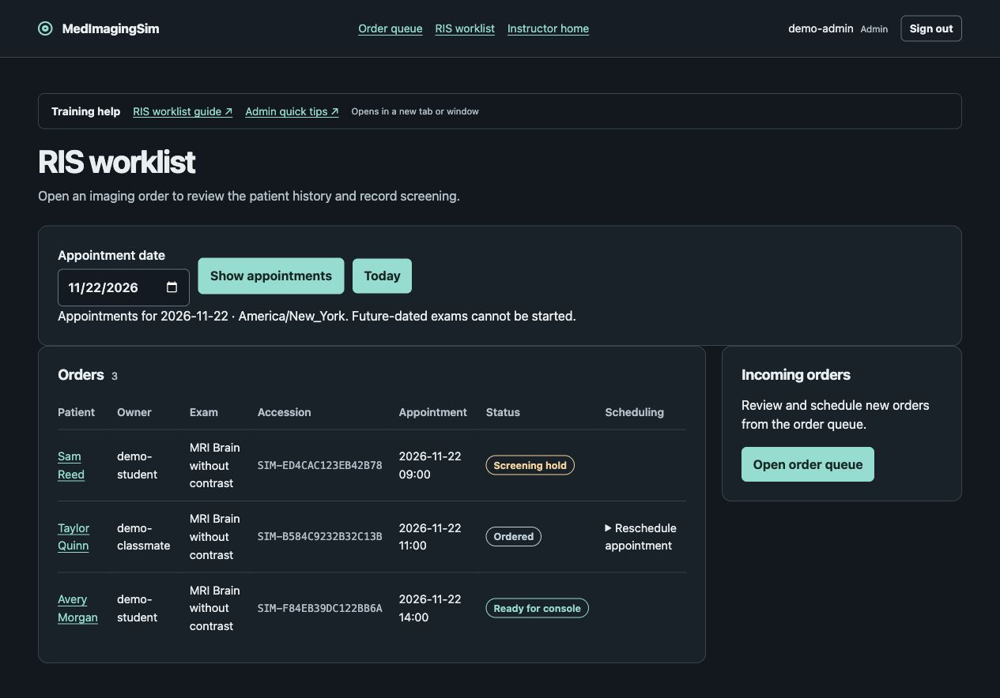

# Administrator quick tips

**MedImagingSim V 1.0.3 · November 22, 2026** · [Full guide](../USER_GUIDE.md#administrator-instructions)

**Open:** [Internal test server](https://192.168.0.180:8443/sign-in). Confirm Admin in the header. Admin actions span accessible orders within the current institution.

Use **Training help** in the simulator for the guide section and your role’s tips; links open in a new tab/window without leaving your work.

## Support a learner

1. Open Order queue and check Created by before editing a request. Read Review history and Original order as received.
2. Correct from the exercise data, select an explicit appointment date/time, verify the three completeness checks, and Schedule order. The request keeps its creator as owner.
3. In RIS worklist, use the appointment date filter and Owner column to find the intended exam.
4. For an unstarted appointment, expand Reschedule appointment, confirm date/time, and Save appointment. Rescheduling is unavailable after screening is submitted.
5. Open the patient to inspect screening. Eligible clear cases permit the MRI console, scanning, preview, and Save PACS selection. Admin actions change the saved training case.
6. Select Instructor home to inspect that workspace. Sign out to verify behavior under a separate student/instructor account.

*Owner and appointment date help prevent intervention on the wrong learner's exam.*

## Release check

| Check | Evidence |
| --- | --- |
| Deployment finished | Active ThinkPad commit matches the intended GitHub commit. |
| Correct build | Version below sign-in matches the release; this guide is V 1.0.3. |
| LAN access | A separate network device can sign in over HTTPS. |
| Workflow works | Changed feature behaves as documented under the appropriate roles. |
| Saved work survives | Existing order, screening, scans, and PACS selection still open; check the appointment date. |

Use the [ThinkPad runbook](../LAN_HOSTING.md) for deploy status, service logs, persistent database, backups, and power/lid configuration. A successful push alone does not verify tester availability.

## Account and feature limits

Account creation is a host/operator command, not an admin page. In a correctly configured checkout/database, use `npm run create-user -- username student` (or `instructor` / `admin`); it prints a generated password. Consult the full guide/runbook before operating on the host. There is no in-app password reset, user editor, tenant editor, hold-release control, grading, or full PACS transfer yet. Never use the disposable documentation database as the tester database.

**Problem report:** include version, role, request/accession, appointment date/filter, device/browser, steps, and message. Share credentials privately; screenshots should show only relevant simulator content.
