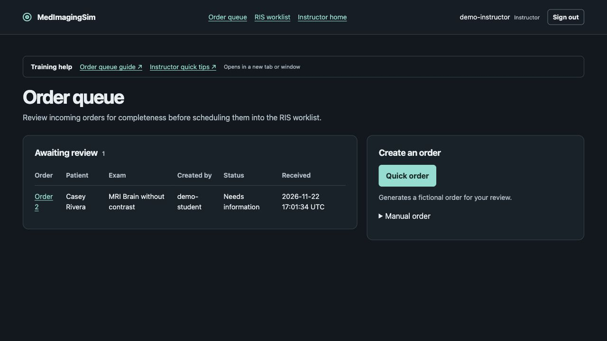

# Instructor quick tips

**MedImagingSim V 1.0.3 · November 22, 2026** · [Full guide](../USER_GUIDE.md#instructor-instructions)

**Open:** [Internal test server](https://192.168.0.180:8443/sign-in). Confirm Instructor in the header. You start in Order queue and see requests in your institution.

Use **Training help** in the simulator for the guide section and your role’s tips; links open in a new tab/window without leaving your work.

## Review a learner's intake work

1. In Order queue, use Created by, patient, exam, and status to identify the request. Open its order number.
2. Read Review history before intervening. Inspect Original order as received to compare the incoming details with corrections.
3. Check demographics, requested exam, reason, and intended appointment date/time against the exercise. A nonblank value can still be wrong.
4. If your teaching plan calls for intervention, Return for missing information or correct the supplied details and Save corrections. Your actions are recorded under your own account.
5. To schedule, enter date/time, verify all three completeness categories, and select Schedule order. You return to Order queue. Ownership stays with the original creator.
6. Open RIS worklist, choose the appointment date, and select the patient to inspect its scheduled intake review.

*Created by identifies the learner; opening the order reveals the history and original received details.*

## Plan a session

- Give each learner their own account, the server address, fictional case details, expected appointment date, and stopping point.
- Expect complete Quick orders 80% of the time and incomplete ones 20%, independently. Appointment date/time are always selected separately.
- Use the persisted intake history for review. Observe the student's screen for scan-planning exercises and ask them to explain changes and selected images.
- Record the request/accession when discussing a problem so everyone refers to the same case.

## Current boundaries

| Available today | Planned / not available yet |
| --- | --- |
| Institution intake review and scheduling | Assignment dispatch and automatic grading |
| Institution RIS date filters and intake links | Instructor acquisition-review workspace |
| Manual and Quick order creation | Instructor MRI console or rescheduling action |
| Instructor home / Submissions placeholder | Cohort setup and isolated/shared scheduling controls |

**No submissions to review** on Instructor home is expected in this version. It does not mean a student's scans were deleted. Instructor accounts do not have the Practice scenarios menu; students/admins do. Do not bypass a screening hold to continue a lesson. Ask an admin for a demonstration when required.
