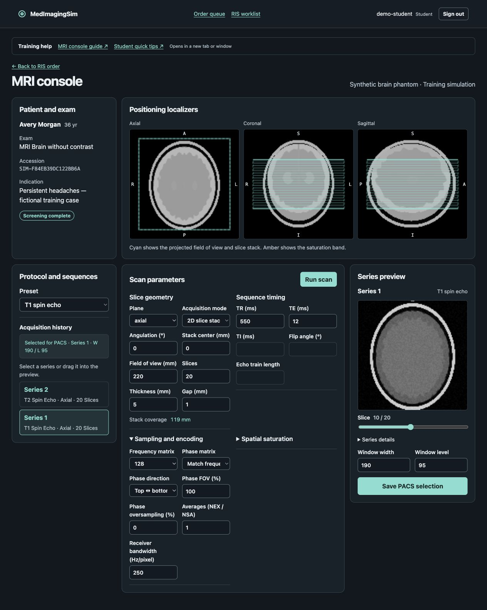

# Student quick tips

**MedImagingSim V 1.0.3 · November 22, 2026** · [Full guide](../USER_GUIDE.md)

**Open:** [Internal test server](https://192.168.0.180:8443/sign-in). Check V 1.0.3 below the sign-in box, sign in with your supplied account, and confirm Student in the header.

Use **Training help** in the simulator for the guide section and your role’s tips; links open in a new tab/window without leaving your work.

## From request to scan

1. **Order queue:** select Quick order, use Manual order, or create a Practice scenario. Open the request number.
2. **Review:** check first/last name, MRN, DOB, recorded sex, exam, and reason. If details are missing, use Return for missing information. Correct only from the exercise data and Save corrections.
3. **Schedule:** choose the intended appointment date/time in the displayed timezone and check all three completeness confirmations. Schedule order returns to Order queue.
4. **RIS worklist:** find the appointment date using Show appointments / Today. Confirm patient, exam, and accession.
5. **Screen:** open the patient; read the history; answer all three questions. Yes or Unsure causes a hold. Submitted answers are read-only.
6. **Scan:** on a clear, date-eligible case, select Open MRI console. Confirm Patient and exam. Choose Preset first, then geometry/timing. Run scan.
7. **Review:** use Slice and Window width/level. Choose an earlier series from Acquisition history or drag it into Series preview.
8. **Select:** Save PACS selection and check the Selected for PACS series number and W/L. This saves a selection, not a PACS transfer or graded submission.

*Left: patient and acquisition history. Top: positioning. Bottom: parameters and preview. The full guide contains larger screenshots and parameter explanations.*

## Remember

| Situation | Quick action |
| --- | --- |
| Exam missing | Check the RIS date, account, and whether it was scheduled. |
| Wrong appointment | Before screening, expand Reschedule appointment, confirm date/time, then Save appointment. |
| Future date | Cannot start. Correct the date only if wrong; later appointments today may start today. |
| Screening hold | Stop and discuss the case. There is no hold-clearance action yet. |
| Repeat scan | Run another acquisition; prior scans remain saved. |
| T1/T2 comparison | Keep geometry, slice, and W/L the same. |
| Invalid timing | TE < TR; for inversion recovery, TI + TE < TR. |
| Invalid coverage | Reduce stack span or move its center toward zero. |
| Returning/reloading | Recheck the preset/plan; unacquired edits are not a saved protocol. |

**Capture for help:** version, role, accession, date filter, browser, steps, and error. Sign out on shared devices. Use fictional data; screenshot names/dates are examples.
